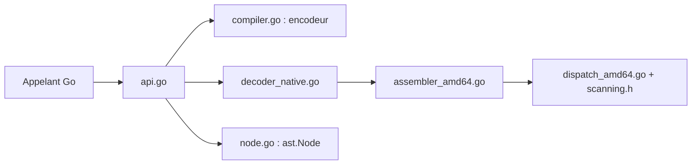

# bytedance/sonic

> Go library for JSON serialization and deserialization, accelerated by JIT and SIMD instructions.

## The problem
Go's `encoding/json` is slow on large volumes of JSON.

## What it actually does
Marshal/Unmarshal without code generation, with runtime binding via a JIT compiler. Also provides a lazy-loading AST (`ast.Node`) to read, search and modify JSON, a Visitor API, streaming input/output and compatibility options. Falls back to `encoding/json` outside supported environments.

## How it is wired


## Trying it
```go
import "github.com/bytedance/sonic"

output, err := sonic.Marshal(&data)
err := sonic.Unmarshal(output, &data)
```

## Cost and gotchas
Free. Go 1.18 to 1.27, AMD64 or ARM64 (Go 1.20+); Go 1.24.0 not supported. The first call on a very large schema can be slow: use `PretouchMany()`. The memory pool may increase consumption.

## What it is not
Does not strictly follow RFC8259 on HTML escaping and key sorting by default. The README's figures come from its own benchmarks on a single machine.

## Alternatives
- jsoniter, go-json, gjson, sjson: compared in the README's benchmarks.

## For you
Watch: of interest if your Go inference service spends a lot of time handling JSON; measure on your own workloads before adopting.
