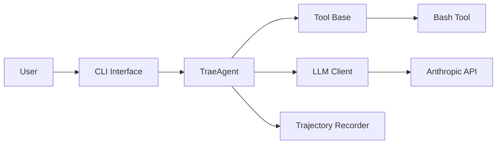

# bytedance/trae-agent

> LLM-driven software-engineering CLI agent, designed for research on agent architectures.

## The problem
CLI coding agents are often opaque and hard to modify when studying or comparing their components.

## What it actually does
`trae-cli run "<task>"` runs an agent loop with bash tools, file editing, sequential thinking, and `task_done`.
Multi-provider: OpenAI, Anthropic, Gemini, Azure, OpenRouter, Doubao, Ollama; YAML config + environment variables.
Records detailed JSON trajectories (LLM calls, tools); "Lakeview" step summaries.
Interactive mode, execution in a Docker container, optional MCP servers.

## How it is wired


## Trying it
```bash
git clone https://github.com/bytedance/trae-agent.git
cd trae-agent
uv sync --all-extras
source .venv/bin/activate
cp trae_config.yaml.example trae_config.yaml
trae-cli run "Create a hello world Python script"
```

## Cost and gotchas
Provider API key at your expense, up to 200 steps per task by default.
Docker mode requires a configured Docker.

## What it is not
Not a finished product competing with agentic IDEs: the emphasis is on study and ablation.
The agent runs real bash: isolate the environment.

## Alternatives
No alternative named in the README (anthropic-quickstart is cited as a reference, not as an alternative).

## For you
Worth watching if you study or evaluate agents: the recorded trajectories are usable for analysis, less so for daily use.
