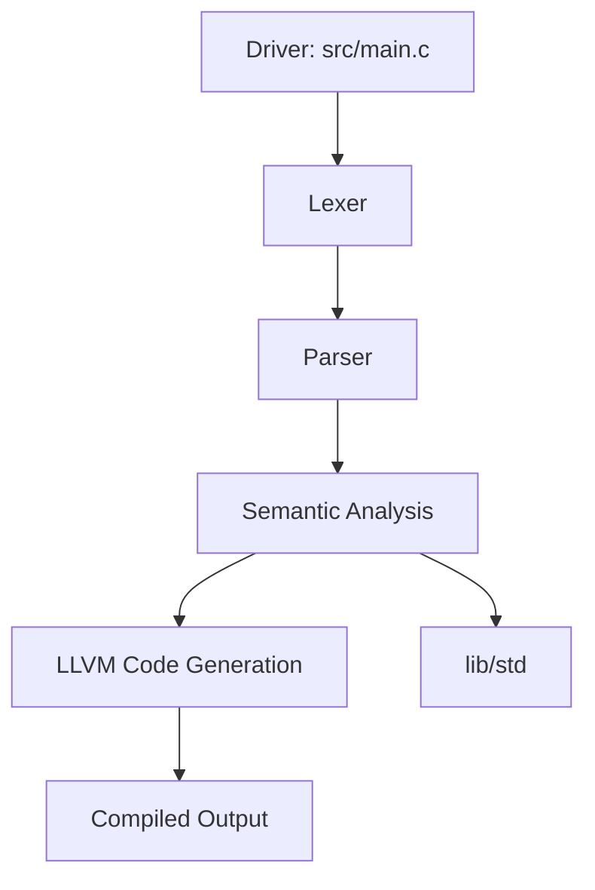

# c3lang/c3c

> Compiler for the C3 language, an ABI-compatible evolution of C, for people who write native software.

## The problem
C lacks modern modules, generics and a macro system, yet you do not want to switch language.

## What it actually does
A C3 compiler: lexer, parser, semantic analysis, then LLVM, assembler or C generation. C-like syntax with modules, slices, generics, defer, result-based errors, compile-time reflection. C and C3 can be mixed. Stable version 0.8.5.

## How it is wired


## Trying it
```bash
curl -fsSL https://raw.githubusercontent.com/c3lang/c3c/refs/heads/master/install/install.sh | bash
c3c compile main.c3
```

## Cost and gotchas
Free. Prebuilt binaries or build with CMake and LLVM. The compiler's licence (LGPL 3.0 for `src`) differs from the rest (MIT): to be checked. The language remains open to major changes.

## What it is not
Not a stabilised language (0.8.x). Not fully supported: many platforms are marked untested.

## Alternatives
No alternative named in the README (inspired by the C2 language).

## For you
Ignore: still experimental systems language, no use for data / AI / MLOps work.
