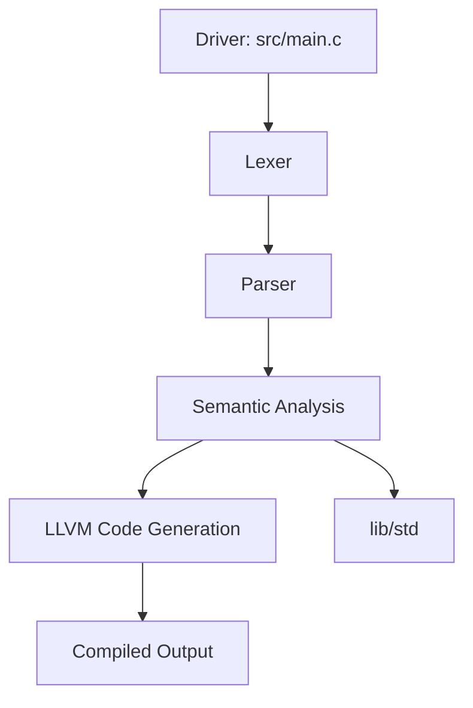

# c3lang/c3c

> Compilateur du langage C3, une évolution de C compatible ABI, pour qui écrit du logiciel natif.

## Le problème
C manque de modules, de génériques et d'un système de macros modernes, sans qu'on veuille changer de langage.

## Ce que ça fait vraiment
Un compilateur C3 : lexer, parseur, analyse sémantique, puis génération LLVM, assembleur ou C. Syntaxe proche de C avec modules, slices, génériques, defer, erreurs par résultat, réflexion à la compilation. On peut mélanger C et C3. Version stable 0.8.5.

## Comment c'est branché


## Essayer
```bash
curl -fsSL https://raw.githubusercontent.com/c3lang/c3c/refs/heads/master/install/install.sh | bash
c3c compile main.c3
```

## Coût et pièges
Gratuit. Binaires précompilés ou compilation avec CMake et LLVM. La licence du compilateur (LGPL 3.0 pour `src`) diffère du reste (MIT) : à vérifier. Le langage reste ouvert à des changements importants.

## Ce que ce n'est pas
Pas un langage stabilisé (0.8.x). Pas de prise en charge complète : beaucoup de plateformes marquées non testées.

## Alternatives
Aucune alternative nommée dans le README (inspiré du langage C2).

## Pour toi
Ignorer : langage de systèmes encore expérimental, sans usage pour un travail data / IA / MLOps.

