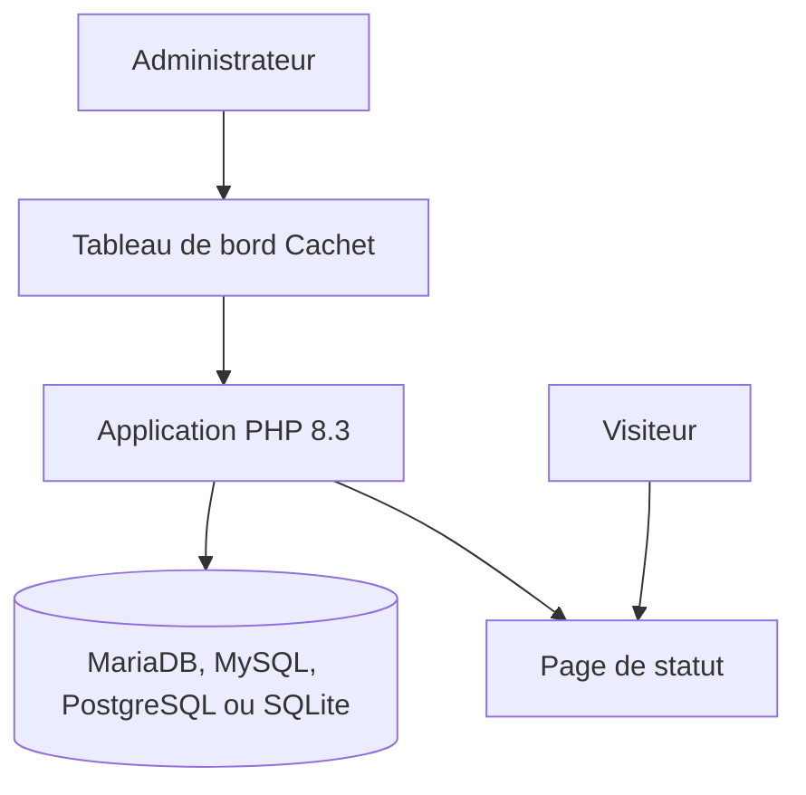

# cachethq/cachet

> Open source, self-hosted status page, to inform users about the state of a service.

## The problem
When a service goes down, users want an independent status page, without depending on a SaaS offering.

## What it actually does
Self-hosted PHP application: dashboard and public status page. The README announces a rewrite in version 3.x. It requires PHP 8.3 or higher, Composer and a MariaDB, MySQL, PostgreSQL or SQLite database. The detail of the features is not described in the README.

## How it is wired
Simplified diagram based on the sheet, no diagram provided.

## Trying it
No command documented in the README: see the documentation at cachethq.io/docs.

## Cost and gotchas
Free. PHP, Composer and a database must be supplied (PHP is not in the prerequisites list). License present but not identified. The public demo account (test@test.com) is reset every 30 minutes.

## What it is not
Not a monitoring tool: it displays statuses, it does not detect outages according to the README.

## Alternatives
No alternative named in the README.

## For you
To watch: handy for publishing the state of a model API or an internal platform, provided you master the PHP stack.
