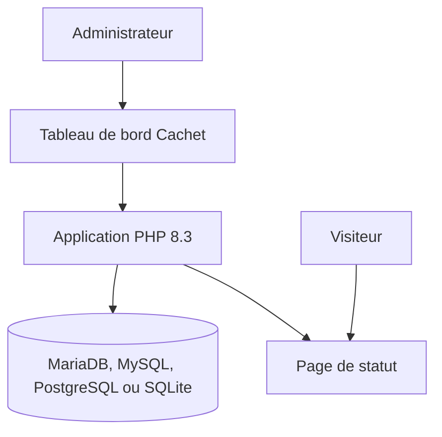

# cachethq/cachet

> Page de statut open source et auto-hébergée, pour informer les utilisateurs sur l'état d'un service.

## Le problème
Quand un service tombe, les utilisateurs veulent une page de statut indépendante, sans dépendre d'une offre SaaS.

## Ce que ça fait vraiment
Application PHP à héberger soi-même : tableau de bord et page publique de statut. Le README annonce une réécriture en version 3.x. Il exige PHP 8.3 ou plus, Composer et une base MariaDB, MySQL, PostgreSQL ou SQLite. Le détail des fonctions n'est pas décrit dans le README.

## Comment c'est branché
Schéma simplifié d'après la fiche, sans diagramme fourni.

## Essayer
Aucune commande documentée dans le README : voir la documentation sur cachethq.io/docs.

## Coût et pièges
Gratuit. PHP, Composer et une base sont à fournir (PHP n'existe pas dans la liste des prérequis). Licence présente mais non identifiée. Le compte de démo public (test@test.com) est réinitialisé toutes les 30 minutes.

## Ce que ce n'est pas
Ce n'est pas un outil de supervision : il affiche des statuts, il ne détecte pas les pannes d'après le README.

## Alternatives
Aucune alternative nommée dans le README.

## Pour toi
À surveiller : pratique pour publier l'état d'une API de modèle ou d'une plateforme interne, à condition de maîtriser la pile PHP.

