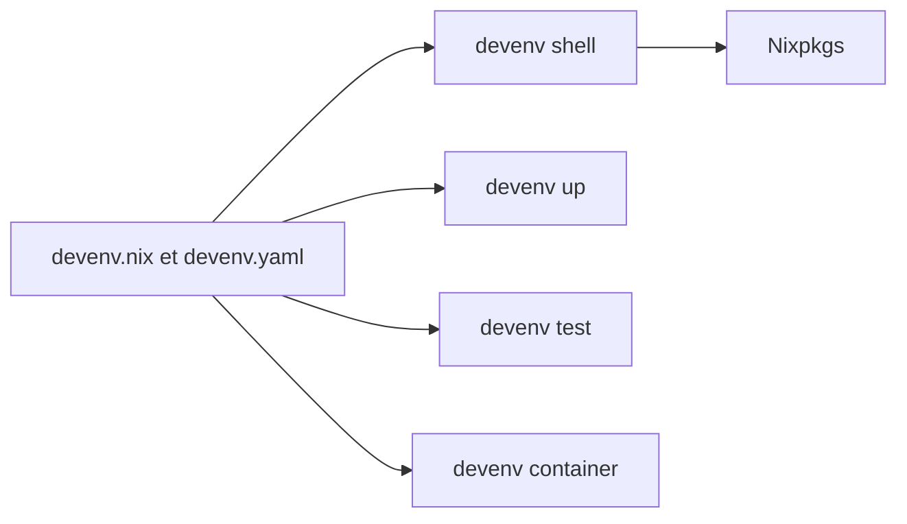

# cachix/devenv

> Command-line tool that describes a reproducible development environment in Nix, for teams.

## The problem
Every workstation has its own versions of languages, databases and services, and "it works on my machine" costs onboarding time.

## What it actually does
A `devenv.nix` file declares languages, packages, services (PostgreSQL, Redis…), processes, tasks and git hooks. `devenv shell` activates the environment, `devenv up` launches the processes, `devenv test` starts and stops them for tests. It can also build OCI containers and exposes an MCP server for AI assistants.

## How it is wired
Simplified diagram based on the fiche, no diagram provided.


## Trying it
```bash
devenv init
devenv shell
devenv up
devenv test
```

## Cost and gotchas
Free. The README relies on Nix and Nixpkgs: installing Nix itself is not detailed in this excerpt. 378 open issues.

## What it is not
It is not Docker: OCI containers are produced without Docker, but the working environment goes through Nix. You need to learn the Nix language to go beyond the generated file.

## Alternatives
No alternative named in the README.

## For you
Watch: useful for pinning a Python environment, services and an MCP server for an AI project, provided you accept the Nix learning curve.
