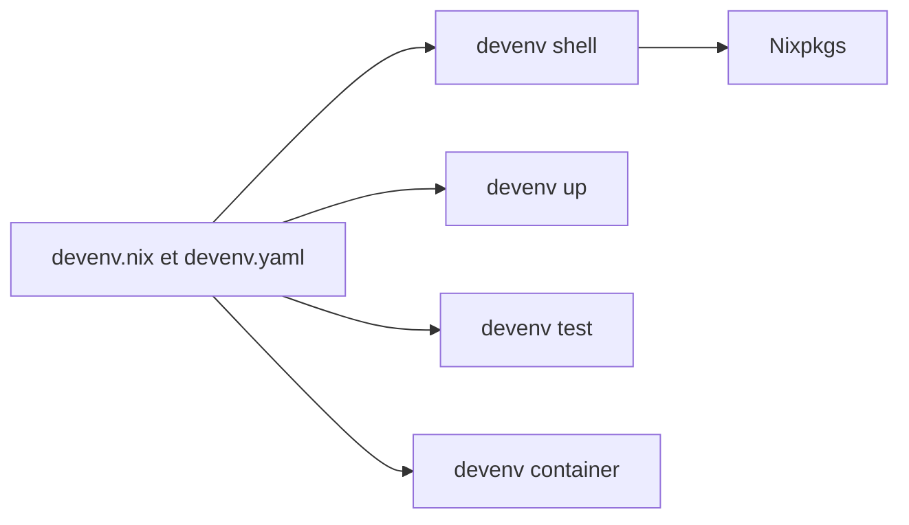

# cachix/devenv

> Outil en ligne de commande qui décrit un environnement de développement reproductible en Nix, pour les équipes.

## Le problème
Chaque poste a ses versions de langages, de bases et de services, et « ça marche chez moi » coûte du temps d'intégration.

## Ce que ça fait vraiment
Un fichier `devenv.nix` déclare langages, paquets, services (PostgreSQL, Redis…), processus, tâches et hooks git. `devenv shell` active l'environnement, `devenv up` lance les processus, `devenv test` les démarre et les arrête pour les tests. Il peut aussi construire des conteneurs OCI et expose un serveur MCP pour les assistants IA.

## Comment c'est branché
Schéma simplifié d'après la fiche, sans diagramme fourni.


## Essayer
```bash
devenv init
devenv shell
devenv up
devenv test
```

## Coût et pièges
Gratuit. Le README s'appuie sur Nix et Nixpkgs : l'installation de Nix elle-même n'est pas détaillée dans cet extrait. 378 issues ouvertes.

## Ce que ce n'est pas
Ce n'est pas Docker : les conteneurs OCI sont produits sans Docker, mais l'environnement de travail passe par Nix. Il faut apprendre le langage Nix pour aller au-delà du fichier généré.

## Alternatives
Aucune alternative nommée dans le README.

## Pour toi
À surveiller : utile pour figer un environnement Python, des services et un serveur MCP de projet IA, à condition d'accepter la courbe d'apprentissage de Nix.

