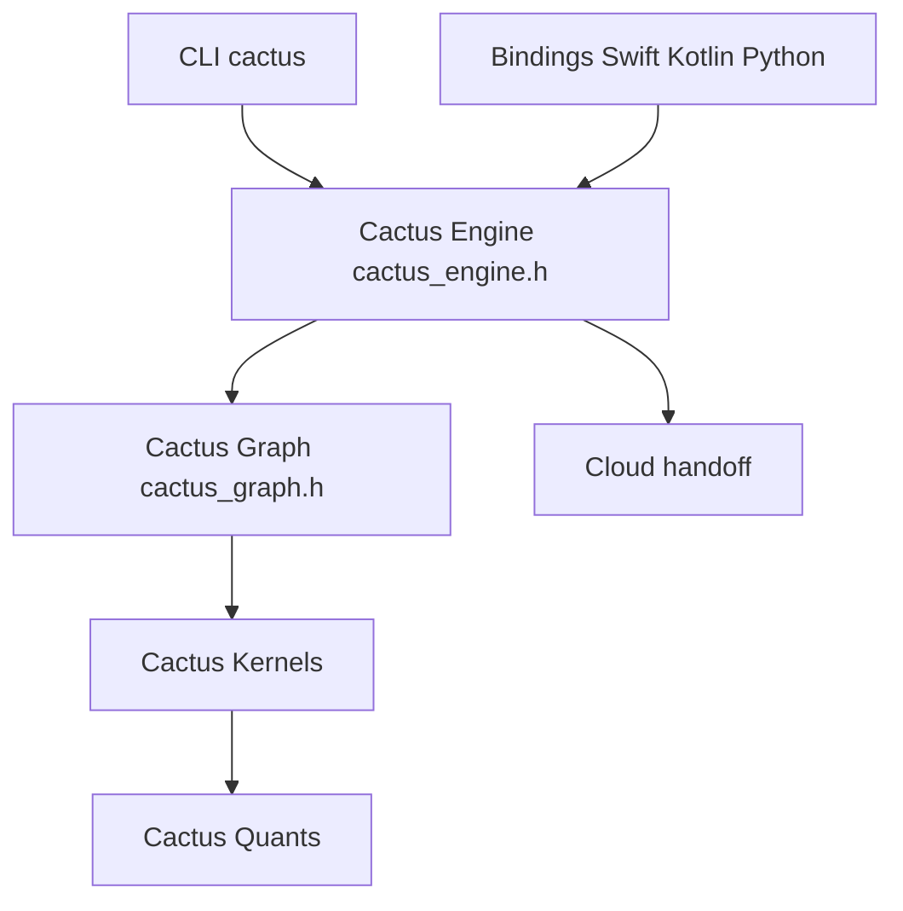

# cactus-compute/cactus

> Hybrid edge-cloud inference engine for phones and connected devices, with in-house kernels and quantization.

## The problem
Models run poorly on phones: limited memory, device-specific CPU/GPU kernels, and no fallback to the cloud when the local model is unsure.

## What it actually does
Four layers: an engine (OpenAI-style API for text, voice, vision), a zero-copy compute graph, ARM NEON kernels, and rotation-based quantization (CQ, 1 to 4 bits). A "cloud handoff" mode switches to the cloud below a confidence threshold. `cactus` CLI: run, serve, convert, benchmark, code. Bindings for Swift, Kotlin, Flutter, React Native, Python, Rust.

## How it is wired


## Trying it
```bash
brew install cactus-compute/cactus/cactus
cactus run
```

## Cost and gotchas
Free locally; the cloud fallback needs a key (`cactus auth`). Telemetry is disabled by default in tests. License not identified by GitHub.

## What it is not
Not a model library: you convert Hugging Face weights. The supplied GitDiagram architecture describes an older version (GGML) that no longer matches the README.

## Alternatives
- RunAnywhere: multi-platform SDK on a C++ core, cited in the batch (neighboring repo).

## For you
Worth watching if you port models to mobile: the per-device measurements are useful, but check the license.
