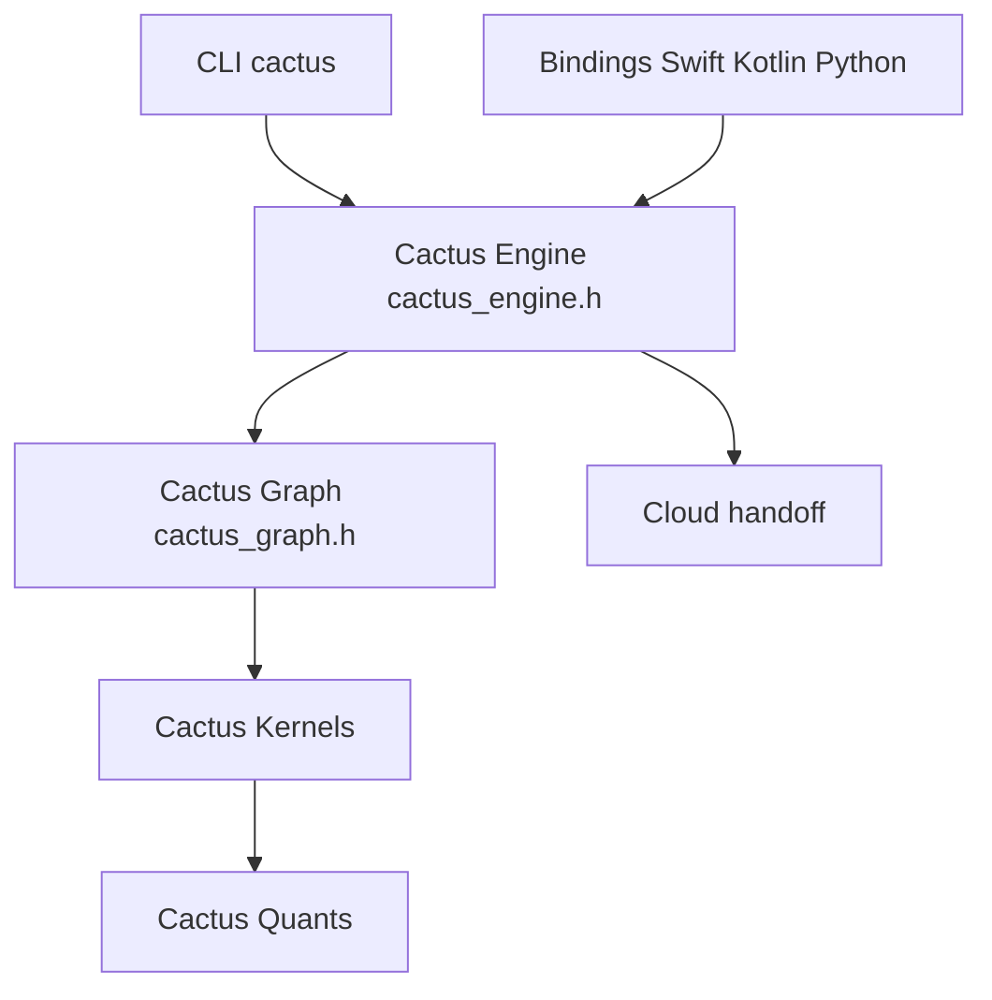

# cactus-compute/cactus

> Moteur d'inférence hybride edge-cloud pour mobiles et objets connectés, avec noyaux et quantification maison.

## Le problème
Les modèles tournent mal sur téléphone : mémoire limitée, noyaux CPU/GPU spécifiques, et aucun repli vers le cloud quand le modèle local doute.

## Ce que ça fait vraiment
Quatre couches : moteur (API de type OpenAI pour texte, voix, vision), graphe de calcul sans copie, noyaux ARM NEON, quantification par rotation (CQ, 1 à 4 bits). Un mode « cloud handoff » bascule vers le cloud sous un seuil de confiance. CLI `cactus` : run, serve, convert, benchmark, code. Liaisons Swift, Kotlin, Flutter, React Native, Python, Rust.

## Comment c'est branché


## Essayer
```bash
brew install cactus-compute/cactus/cactus
cactus run
```

## Coût et pièges
Gratuit en local ; le repli cloud nécessite une clé (`cactus auth`). Télémétrie désactivée par défaut dans les tests. Licence non identifiée par GitHub.

## Ce que ce n'est pas
Pas une librairie de modèles : on convertit des poids Hugging Face. L'architecture GitDiagram fournie décrit une ancienne version (GGML) qui ne correspond plus au README.

## Alternatives
- RunAnywhere : SDK multi-plateformes sur un cœur C++, cité dans le lot (dépôt voisin).

## Pour toi
À surveiller si tu portes des modèles sur mobile : les mesures par appareil sont utiles, mais vérifie la licence.

