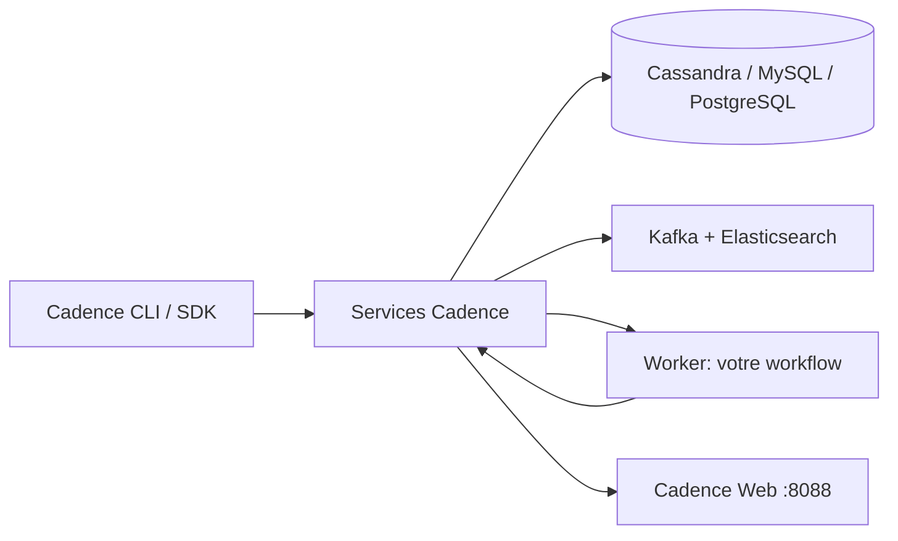

# cadence-workflow/cadence

> Orchestration engine for long-running, fault-tolerant workflows, open source since 2017.

## The problem
A process that lasts hours or days and must survive restarts does not fit in
a cron: you need to persist state, replay history and retry failed steps.

## What it actually does
Provides the orchestration engine and its tooling: CLI, schema management, load bench and canary.
The backend groups several services, a database (Cassandra, MySQL or PostgreSQL) and, optionally,
Kafka and Elasticsearch. The user writes a **worker** containing the workflow implementation, then
triggers executions via SDK or CLI. A web interface on port 8088 shows histories and
detailed traces. Kubernetes deployment via the official `cadence-charts` chart.

## How it is wired


## Trying it
```bash
docker compose -f docker/docker-compose.yml up
brew install cadence-workflow
docker run --rm ubercadence/cli:master
make cadence
```

## Cost and gotchas
Free, but the infrastructure is heavy: several services, a database, often Kafka and
Elasticsearch. Schema upgrades are manual — the README notably details that the old Elasticsearch
schema must be moved before `brew upgrade`, otherwise it will not be updated.

## What it is not
Not a lightweight task scheduler: it is comparable neither to a cron nor to a simple queue.
Not a product without operational effort. The Python and Ruby SDKs are **unofficial**, carried by the
community; only Go and Java are official. No license in this README.

## Alternatives
- **iWF**: DSL framework built on top of Cadence, simpler to write.
- **KubeStellar Console**: guided Kubernetes installation walkthrough via `cadence-charts`.

## For you
Relevant if your pipelines last days; otherwise operating it costs more than the problem.
