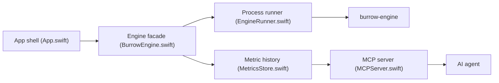

# caezium/Burrow

> A Mac cleanup and monitoring app, with an MCP server that lets an AI agent inspect it.

## The problem
Clean up caches, dev artifacts (`node_modules`, `target/`…), installers and leftover apps, and track the machine's state, without stacking several tools.

## What it actually does
A SwiftUI app (macOS 14+, Windows preview) that embeds `burrow-engine`, a binary whose commands mirror those of the `mo` tool. It does cleanup, purge, uninstall, maintenance, a disk map and a live dashboard, and keeps a SQLite history of metrics. Its MCP server (19 tools, read-only by default) exposes this data; destructive actions require `confirm:true` and an enabled setting.

## How it is wired


## Trying it
```bash
brew install --cask caezium/tap/burrow
claude mcp add burrow -- /Applications/Burrow.app/Contents/MacOS/Burrow --mcp
```

## Cost and gotchas
Free. The app sends anonymous usage statistics that can be disabled (PostHog, see TELEMETRY.md). Root elevation goes through the macOS dialog. The Windows version is an unsigned preview.

## What it is not
The repo is MIT but the embedded engine is under the FSL-1.1 license (source available, commercial clauses). It is not the official Mole app. The cleanup action is gated, but permanent deletion remains irreversible.

## Alternatives
mole.fit (app by the author of `mo`, $19), CleanMyMac, Pearcleaner, `mo` / ncdu.

## For you
Worth watching: the idea of an MCP server that gives an agent the state of your machine is useful, but this is a macOS maintenance tool, not a data/AI one; reread the engine's FSL license before any professional use.
