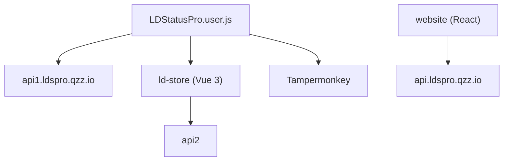

# caigg188/LDStatusPro

> User script that adds level tracking, reading statistics and a leaderboard to the Linux.do and IDCFlare forums.

## The problem
The Linux.do and IDCFlare forums do not offer detailed tracking of your trust level progress or your reading time.

## What it actually does
A Tampermonkey script displays a panel with progress, reading time, leaderboard, cloud sync (via api1.ldspro.qzz.io), AI thread summaries, LDC points balance and a CDK panel. The repository also contains a store site (Vue 3) and a showcase site (React). The server, administration and security are in other repositories. README in Chinese.

## How it is wired


## Trying it
```bash
# Pas de commande : installer Tampermonkey, puis le script depuis GitHub ou GreasyFork,
# et ouvrir Linux.do ou IDCFlare.
```

## Cost and gotchas
Free, but sync and leaderboard depend on a third-party server outside the repository. OAuth login with a forum account. The AI summary requires an OpenAI-compatible service that you configure.

## What it is not
Not standalone: the cloud features rely on a backend you do not control. Reserved for two specific communities.

## Alternatives
No alternative named in the README.

## For you
Ignore: extension for two specific forums, with a third-party backend, unrelated to data or AI work.
