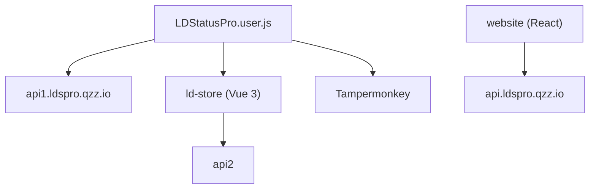

# caigg188/LDStatusPro

> Script utilisateur qui ajoute suivi de niveau, statistiques de lecture et classement aux forums Linux.do et IDCFlare.

## Le problème
Les forums Linux.do et IDCFlare n'offrent pas de suivi détaillé de ta progression de niveau de confiance ni de ton temps de lecture.

## Ce que ça fait vraiment
Un script Tampermonkey affiche un panneau avec progression, temps de lecture, classement, synchronisation cloud (via api1.ldspro.qzz.io), résumé de fils par IA, solde de points LDC et panneau CDK. Le dépôt contient aussi un site de boutique (Vue 3) et un site vitrine (React). Le serveur, l'administration et la sécurité sont dans d'autres dépôts. README en chinois.

## Comment c'est branché


## Essayer
```bash
# Pas de commande : installer Tampermonkey, puis le script depuis GitHub ou GreasyFork,
# et ouvrir Linux.do ou IDCFlare.
```

## Coût et pièges
Gratuit, mais la synchronisation et le classement dépendent d'un serveur tiers hors dépôt. Connexion OAuth avec un compte de forum. Le résumé IA exige un service compatible OpenAI que tu configures.

## Ce que ce n'est pas
Pas autonome : les fonctions cloud reposent sur un backend que tu ne contrôles pas. Réservé à deux communautés précises.

## Alternatives
Aucune alternative nommée dans le README.

## Pour toi
À ignorer : extension pour deux forums précis, avec un backend tiers, sans rapport avec le travail data ou IA.

