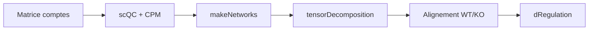

# cailab-tamu/scTenifoldKnk

> R package for virtual gene knockout from wild-type scRNA-seq cells.

## The problem
Predicting the effect of knocking out a gene requires costly experiments.

## What it actually does
Builds a regulatory network (principal component regression), denoises it by CP tensor decomposition, zeroes the outgoing edges of the target gene, aligns the networks (manifold or heat kernel) and tests the genes whose regulation changes. v2 also predicts the direction (up/down) and covers the whole transcriptome.

## How it is wired


## Trying it
```r
install.packages("scTenifoldKnk")
out <- scTenifoldKnk(X, gKO = "ng10", qc_minLibSize = 30)
plotKO(out, gKO = "ng10")
```

## Cost and gotchas
Free. Memory grows with the square of the number of genes: 8.6 GB for 5,000 genes, 34 GB for 10,000. Manifold mode on the whole transcriptome: about 3.6 h at 5,000 genes.

## What it is not
Not a substitute for experiments: virtual knockouts prioritize candidates. The predicted direction mostly reflects the common response.

## Alternatives
scTenifoldpy (Python) and scGEAToolbox (MATLAB), cited in the README.

## For you
Worth watching: an interesting method (tensors, heat kernel) if you do bio-AI; undeclared license to clarify.
