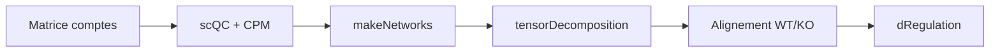

# cailab-tamu/scTenifoldKnk

> Package R de knockout virtuel de gènes à partir de scRNA-seq de cellules sauvages.

## Le problème
Prédire l'effet de l'invalidation d'un gène demande des expériences coûteuses.

## Ce que ça fait vraiment
Construit un réseau de régulation (régression sur composantes principales), le débruite par décomposition tensorielle CP, met à zéro les arêtes sortantes du gène cible, aligne les réseaux (variété ou noyau de chaleur) et teste les gènes dont la régulation change. La v2 prédit aussi la direction (up/down) et couvre le transcriptome entier.

## Comment c'est branché


## Essayer
```r
install.packages("scTenifoldKnk")
out <- scTenifoldKnk(X, gKO = "ng10", qc_minLibSize = 30)
plotKO(out, gKO = "ng10")
```

## Coût et pièges
Gratuit. Mémoire en carré du nombre de gènes : 8,6 Go pour 5 000 gènes, 34 Go pour 10 000. Mode manifold sur le transcriptome entier : environ 3,6 h à 5 000 gènes.

## Ce que ce n'est pas
Pas un substitut à l'expérience : les knockouts virtuels priorisent des candidats. La direction prédite reflète surtout la réponse commune.

## Alternatives
scTenifoldpy (Python) et scGEAToolbox (MATLAB), cités dans le README.

## Pour toi
À surveiller : méthode intéressante (tenseurs, noyau de chaleur) si tu fais de la bio-IA ; licence non déclarée à clarifier.

