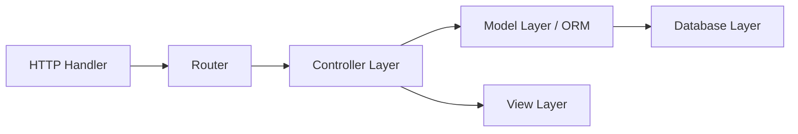

# cakephp/cakephp

> PHP MVC web framework for building applications quickly, aimed at PHP developers.

## The problem
Writing a PHP web application without structure means redoing routing, database access and validation in every project.

## What it actually does
MVC framework providing routing, ORM, HTTP layer, cache, internationalization, authentication, events, console and a plugin system. It uses well-known patterns (Associative Data Mapping, Front Controller). A foundation (Cake Software Foundation) is cited.

## How it is wired


## Trying it
```bash
composer require cakephp/cakephp
cp phpunit.xml.dist phpunit.xml
vendor/bin/phpunit
```

## Cost and gotchas
Free. PHP, Composer and PHPUnit are required; compatible PHP versions are listed in the site's version table.

## What it is not
Not a data or AI tool. The README recommends the skeleton application for a new project rather than the repository alone.

## Alternatives
- No alternative named in the README.

## For you
Ignore: PHP web framework unrelated to data/AI pipelines, useful only if you maintain a PHP application.
