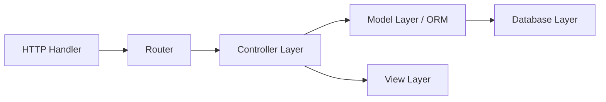

# cakephp/cakephp

> Framework web PHP en MVC pour développer vite des applications, destiné aux développeurs PHP.

## Le problème
Écrire une application web PHP sans structure impose de refaire routage, accès base de données et validation à chaque projet.

## Ce que ça fait vraiment
Framework MVC qui fournit routage, ORM, couche HTTP, cache, internationalisation, authentification, événements, console et système de plugins. Il utilise des motifs connus (Associative Data Mapping, Front Controller). Une fondation (Cake Software Foundation) est citée.

## Comment c'est branché


## Essayer
```bash
composer require cakephp/cakephp
cp phpunit.xml.dist phpunit.xml
vendor/bin/phpunit
```

## Coût et pièges
Gratuit. Il faut PHP, Composer et PHPUnit ; les versions de PHP compatibles se lisent dans la table de versions du site.

## Ce que ce n'est pas
Pas un outil data ou IA. Le README recommande l'application squelette pour un nouveau projet plutôt que le dépôt seul.

## Alternatives
- Aucune alternative nommée dans le README.

## Pour toi
À ignorer : framework web PHP sans lien avec les pipelines data/IA, utile seulement si tu maintiens une application PHP.

