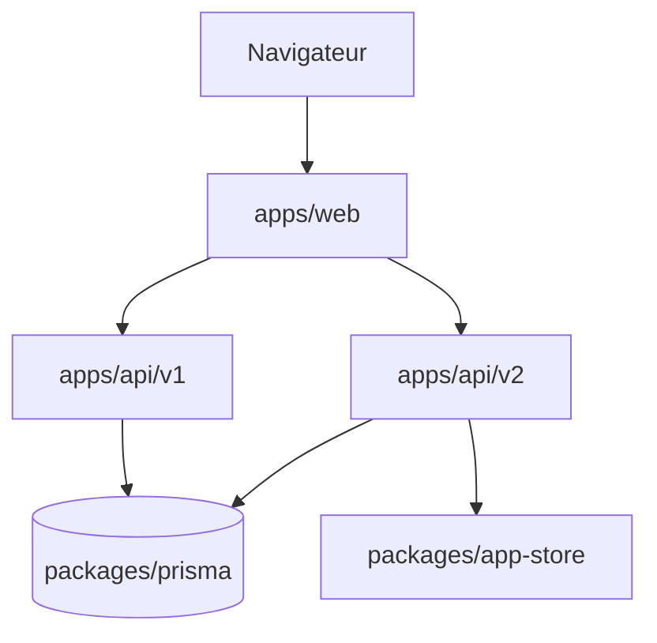

# calcom/cal.com

> Self-hosted appointment scheduling platform (community edition, Cal.diy, no business code).

## The problem
Plan to make appointments without using a commercial booking service or revealing your schedule.

## What it actually does
The README describes Cal.diy, a MIT-licensed fork of Cal.com without Teams, Organizations, Insights, Workflows, or SSO. The stack consists of Next.js, tRPC, Prisma on PostgreSQL, and integrations with Google, Microsoft, and Zoom. Deployment is done using Docker Compose. The README is truncated in the source; the rest of the integrations have not been read.

## How it is wired


## Trying it
```bash
git clone https://github.com/calcom/cal.diy.git
cd cal.diy
cp .env.example .env
docker compose up -d
```

## Cost and gotchas
PostgreSQL 13+, Node 18+, two keys to generate (`NEXTAUTH_SECRET`, `CALENDSO_ENCRYPTION_KEY`), VAPID keys for notifications. Vercel requires the Pro plan. Telemetry can be disabled with `CALCOM_TELEMETRY_DISABLED=1`.

## What it is not
This is not a hosted offer or ready-to-use solution for the company: the README discourages its use in production. The cal.com repository is not what the README describes (Cal.diy).

## Alternatives
Hosted by Cal.com (commercial version as referenced in the README).

## For you
Outside the data/AI scope, this is a resource-intensive component (requiring a database, secrets, and OAuth), and is not recommended for production use; it should be ignored.
