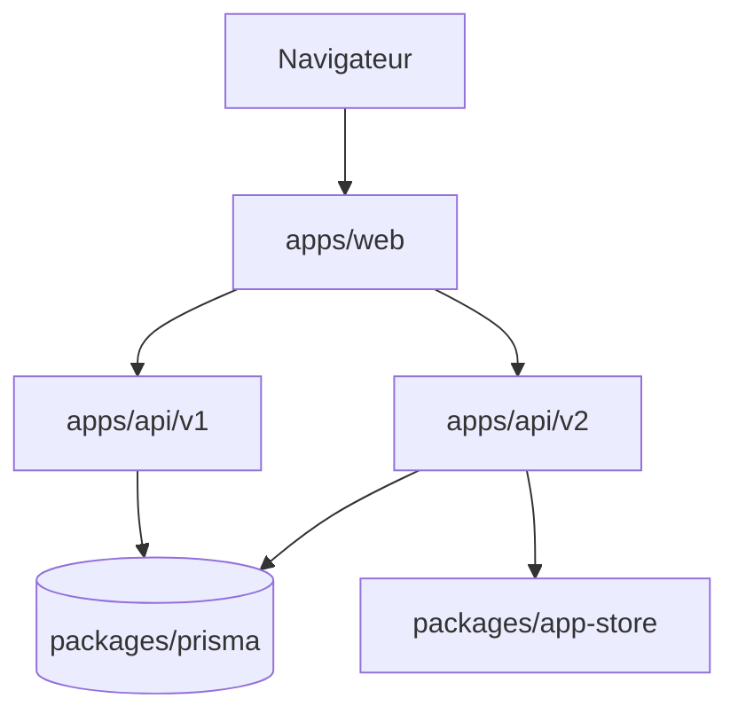

# calcom/cal.com

> Plateforme de prise de rendez-vous à héberger soi-même (édition communautaire Cal.diy, sans code entreprise).

## Le problème
Planifier des rendez-vous sans passer par un service de réservation commercial ni exposer ses agendas.

## Ce que ça fait vraiment
Le README décrit Cal.diy, un fork MIT de Cal.com sans Teams, Organizations, Insights, Workflows ni SSO. Stack : Next.js, tRPC, Prisma sur PostgreSQL, intégrations Google, Microsoft, Zoom. Déploiement par Docker Compose. Le README est tronqué dans la source ; la suite des intégrations n'a pas été lue.

## Comment c'est branché


## Essayer
```bash
git clone https://github.com/calcom/cal.diy.git
cd cal.diy
cp .env.example .env
docker compose up -d
```

## Coût et pièges
PostgreSQL 13+, Node 18+, deux clés à générer (`NEXTAUTH_SECRET`, `CALENDSO_ENCRYPTION_KEY`), clés VAPID pour les notifications. Vercel exige l'offre Pro. Télémétrie à couper avec `CALCOM_TELEMETRY_DISABLED=1`.

## Ce que ce n'est pas
Pas une offre hébergée ni prête pour l'entreprise : le README le déconseille pour la production. Le dépôt cal.com n'est pas ce que décrit le README (Cal.diy).

## Alternatives
Cal.com hébergé (version commerciale citée dans le README).

## Pour toi
Hors périmètre data/IA, lourd à exploiter (base, secrets, OAuth) et déconseillé en production : à ignorer.

