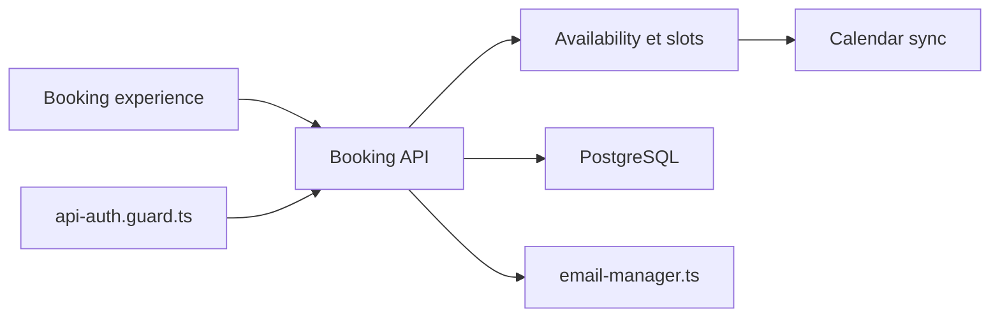

# calcom/cal.diy

> Self-hosted appointment scheduling platform, MIT-licensed fork of Cal.com's code, without any proprietary code.

## The problem
Tools for scheduling, hosted on your own servers, allow you to manage your calendars; Cal.com offers features specifically designed for business use.

## What it actually does
Configure availability and schedules, propose time slots, create and manage bookings, and notify participants. No teams, organizations, SSO, or workflows. Built on Next.js, tRPC, Prisma, and PostgreSQL; video conferencing via Daily.co. The README discourages use in a production environment.

## How it is wired


## Trying it
```bash
git clone --recursive https://github.com/calcom/cal.diy.git
cd cal.diy
cp .env.example .env
docker compose up -d
```

## Cost and gotchas
Free but self-hosted: you need to generate `NEXTAUTH_SECRET` and `CALENDSO_ENCRYPTION_KEY`, configure OAuth (Google, Zoom, Microsoft, etc.), and create third-party accounts (Daily.co). Telemetry can be disabled with `CALCOM_TELEMETRY_DISABLED=1`. No hosted version available.

## What it is not
According to the README, it is not ready for production. It directs users to Cal.com for support. There is no official support.

## Alternatives
Cal.com (for business and commercial use).

## For you
To be ignored: a planning tool that is not linked to data/AI, and its own README discourages its use.
