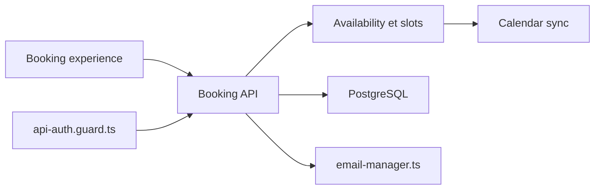

# calcom/cal.diy

> Plateforme de prise de rendez-vous auto-hébergée, fork communautaire MIT de Cal.com sans code entreprise.

## Le problème
Les outils de planification hébergés enferment tes agendas ; Cal.com a des fonctions réservées à l'édition entreprise.

## Ce que ça fait vraiment
Configure disponibilités et agendas, propose des créneaux, crée et gère les réservations et prévient les participants. Pas d'équipes, organisations, SSO ni workflows. Pile Next.js, tRPC, Prisma, PostgreSQL ; visioconférence via Daily.co. Le README déconseille l'usage en production.

## Comment c'est branché


## Essayer
```bash
git clone --recursive https://github.com/calcom/cal.diy.git
cd cal.diy
cp .env.example .env
docker compose up -d
```

## Coût et pièges
Gratuit mais auto-hébergé : il faut générer `NEXTAUTH_SECRET` et `CALENDSO_ENCRYPTION_KEY`, configurer OAuth (Google, Zoom, Microsoft…) et créer des comptes tiers (Daily.co). Télémétrie désactivable avec `CALCOM_TELEMETRY_DISABLED=1`. Pas de version hébergée.

## Ce que ce n'est pas
Pas prêt pour la production selon le README ; pour ça il renvoie vers Cal.com. Pas de support officiel.

## Alternatives
Cal.com (édition commerciale et entreprise).

## Pour toi
À ignorer : outil de planification sans lien avec la data/IA, et son propre README déconseille la production.

