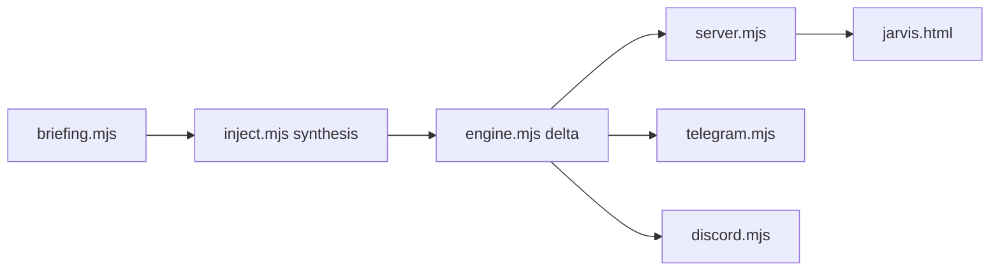

# calesthio/Crucix

> Local dashboard aggregating 27 open sources (conflicts, markets, satellites) and sending alerts via Telegram or Discord.

## The problem
Real-time public data is scattered across dozens of APIs that nobody checks one by one.

## What it actually does
Every 15 minutes, it queries 27 sources in parallel (GDELT, OpenSky, NASA FIRMS, FRED, Yahoo Finance…), synthesizes the results, computes the delta against the previous run and pushes it to the browser via SSE. With an LLM (8 providers), it generates ideas and ranks alerts as FLASH/PRIORITY/ROUTINE; without an LLM, rules take over.

## How it is wired


## Trying it
```bash
git clone https://github.com/calesthio/Crucix.git
cd Crucix
npm install
cp .env.example .env
npm run dev
```

## Cost and gotchas
Node 22+. 18 sources need no key; free FRED, FIRMS and EIA keys are recommended; ADS-B Exchange costs about $10/month. LLM at your expense. AGPL-3.0.

## What it is not
Not financial advice: the "ideas" are LLM-generated. The project has no official token despite the README's warnings.

## Alternatives
Not documented: the README names no alternative.

## For you
Keep an eye on it: a good example of multi-source aggregation and change detection, but young, with a single maintainer, and under AGPL.
