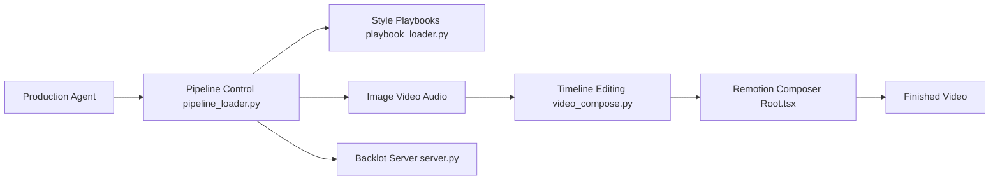

# calesthio/OpenMontage

> Video production pipelines managed by an AI code assistant, from brief to final output.

## The problem
Creating a video (script, visuals, voice-over, music, editing) using AI requires managing various tools and providers without clear cost tracking.

## What it actually does
No orchestrator: the assistant (e.g., Claude Code, Cursor, Codex…) reads YAML manifests (`pipeline_defs/`) and Markdown skills, and then calls Python tools.
Steps: research → proposal → script → scene plan → assets → edit → compose, with human validation.
Rendering: Remotion or HyperFrames, post-production with FFmpeg; TTS Piper offline and free, without requiring a key.
Supplier selection based on 7 criteria, with a default budget of $10 per item, and a local "Backlot" system.

## How it is wired


## Trying it
```bash
git clone https://github.com/calesthio/OpenMontage.git
cd OpenMontage
make setup
python -m backlot open
make test-contracts
```

## Cost and gotchas
Python 3.10+, FFmpeg, Node 18+, an AI assistant (often paid). Image/video generation: ~0.15 to 3 USD per video, depending on the README; GPU for local video processing.

## What it is not
Not a standalone application: without a code assistant, nothing works. The project was created in March 2026. The quality guarantees are described by the author, but not verified here.

## Alternatives
Not documented: no alternative deposit named.

## For you
This is an interesting example of "agent + skills + manifestos" architecture, but it should be observed rather than adopted.
