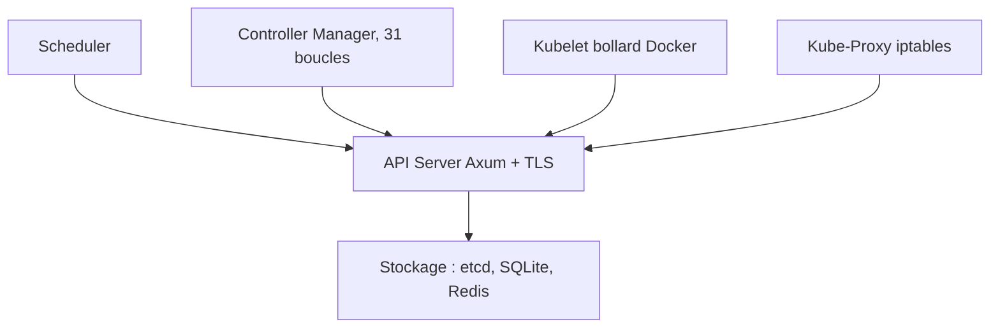

# calfonso/rusternetes

> A reimplementation of Kubernetes in Rust, for anyone who wants a lightweight or local cluster.

## The problem
A full Kubernetes cluster is heavy for edge, continuous-integration or isolated environments.

## What it actually does
The repo rewrites the API server, scheduler, controller manager, kubelet and kube-proxy in Rust, across ten crates. Storage is swappable: etcd, SQLite or Redis through Rhino. A single-binary mode runs the five components in one process. The README claims 94% of the Kubernetes conformance tests (415 out of 441).

## How it is wired


## Trying it
```bash
git clone https://github.com/calfonso/rusternetes.git
cd rusternetes
bash scripts/generate-certs.sh
docker compose build
docker compose -f docker-compose.yml up -d
bash scripts/bootstrap-cluster.sh
export KUBECONFIG=~/.kube/rusternetes-config
kubectl get nodes
```

## Cost and gotchas
You need stable Rust, the protobuf compiler and Docker or Podman. With Podman on Linux, root mode is required for kube-proxy's iptables.

## What it is not
Not an official Kubernetes: 6% of the conformance tests still fail. The controllers and the kubelet go through the Docker API, not a standard CRI runtime (undocumented).

## Alternatives
- Official Kubernetes (Go): the reference, for production.
- Rhino: an etcd-compatible server in Rust, usable on its own to swap the database.

## For you
Worth watching: the one-binary cluster idea is appealing for local MLOps tests, but the project remains experimental and run by one person.
