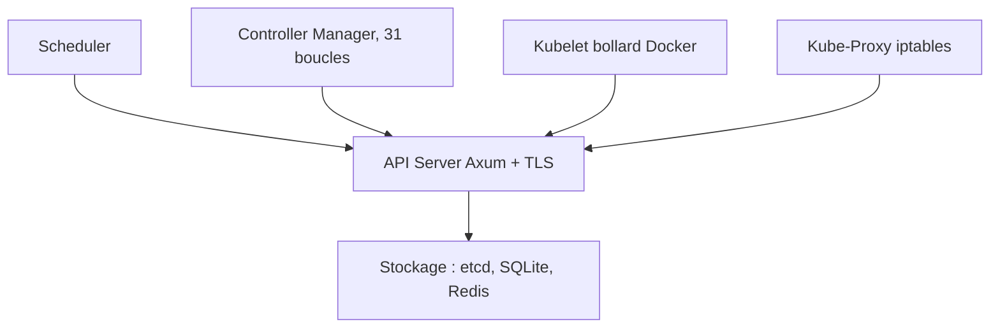

# calfonso/rusternetes

> Réimplémentation de Kubernetes en Rust, pour qui veut un cluster léger ou local.

## Le problème
Un cluster Kubernetes complet est lourd pour des environnements de bord, d'intégration continue ou isolés.

## Ce que ça fait vraiment
Le dépôt réécrit API server, scheduler, controller manager, kubelet et kube-proxy en Rust, dans dix crates. Le stockage est interchangeable : etcd, SQLite ou Redis via Rhino. Un mode binaire unique lance les cinq composants dans un seul processus. Le README annonce 94 % des tests de conformité Kubernetes (415 sur 441).

## Comment c'est branché


## Essayer
```bash
git clone https://github.com/calfonso/rusternetes.git
cd rusternetes
bash scripts/generate-certs.sh
docker compose build
docker compose -f docker-compose.yml up -d
bash scripts/bootstrap-cluster.sh
export KUBECONFIG=~/.kube/rusternetes-config
kubectl get nodes
```

## Coût et pièges
Il faut Rust stable, le compilateur protobuf et Docker ou Podman. Avec Podman sous Linux, le mode root est requis pour les iptables de kube-proxy.

## Ce que ce n'est pas
Pas un Kubernetes officiel : 6 % des tests de conformité échouent encore. Les contrôleurs et le kubelet passent par l'API Docker, pas par un runtime CRI standard (non documenté).

## Alternatives
- Kubernetes officiel (Go) : référence, pour la production.
- Rhino : serveur compatible etcd en Rust, utilisable seul pour changer de base.

## Pour toi
À surveiller : l'idée de cluster en un binaire est séduisante pour des tests MLOps locaux, mais le projet reste expérimental et tenu par une personne.

