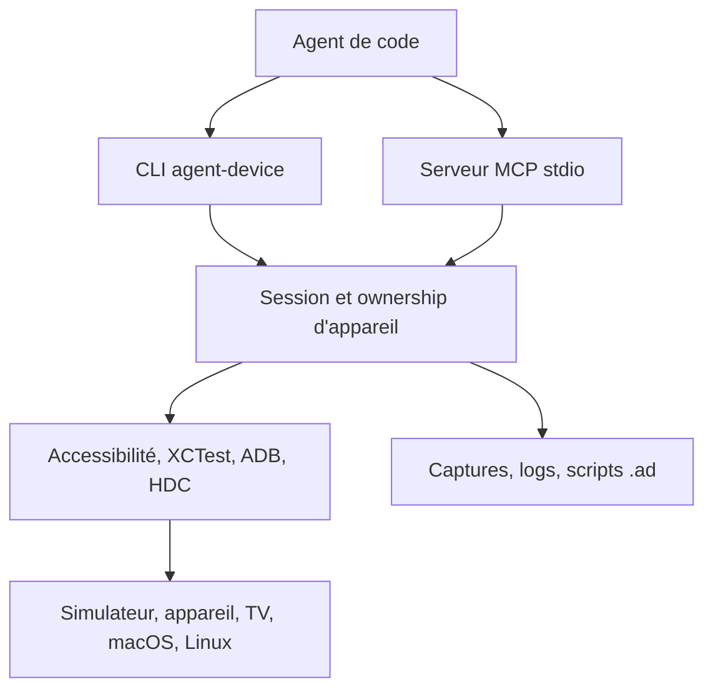

# callstack/agent-device

> CLI/MCP layer that lets a coding agent inspect and drive mobile, web and desktop apps.

## The problem
An agent that modifies an app cannot verify the result in the app running on a simulator or device.

## What it actually does
Sessions keep device state. The agent reads accessibility tree snapshots, acts via references and selectors, then saves screenshots, logs and traces. Flows can be recorded as `.ad` scripts replayable in CI, or exported as Maestro YAML. A CLI, a stdio MCP server and a typed Node API share the same runtime.

## How it is wired
Simplified diagram based on the sheet, no diagram provided.



## Trying it
```bash
npm install -g agent-device@latest
agent-device doctor
agent-device open Contacts --platform ios
agent-device snapshot -i
agent-device press @e2 --settle
agent-device close
```

## Cost and gotchas
Node 22.12+ (24+ for web). Depending on the target you need Xcode, an Android SDK or a cloud device account (BrowserStack, AWS Device Farm…). 120 open issues.

## What it is not
Not a stable test suite like Appium or Detox: the agent chooses commands at runtime. Support varies by target (HarmonyOS and Vega cover a subset).

## Alternatives
- Appium, Detox, Maestro: for repeatable test suites.
- e2e: TypeScript framework cited for stable web and mobile tests.

## For you
Worth watching: only if you have agents validate mobile apps; outside mobile, nothing for a data/MLOps profile.
