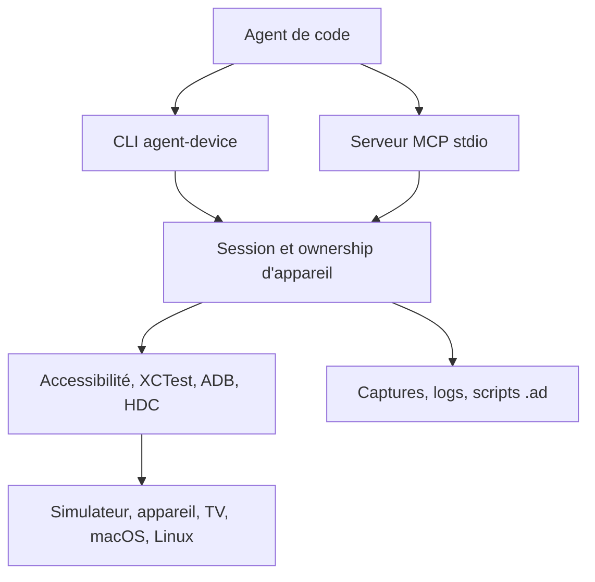

# callstack/agent-device

> Couche CLI/MCP qui laisse un agent de code inspecter et piloter des apps mobiles, web et bureau.

## Le problème
Un agent qui modifie une app ne peut pas vérifier le résultat dans l'app qui tourne sur simulateur ou appareil.

## Ce que ça fait vraiment
Les sessions gardent l'état des appareils. L'agent lit des instantanés de l'arbre d'accessibilité, agit via références et sélecteurs, puis sauvegarde captures, logs et traces. Les parcours peuvent être enregistrés en scripts `.ad` rejouables en CI, ou exportés en YAML Maestro. Une interface CLI, un serveur MCP stdio et une API Node typée partagent le même runtime.

## Comment c'est branché
Schéma simplifié d'après la fiche, sans diagramme fourni.



## Essayer
```bash
npm install -g agent-device@latest
agent-device doctor
agent-device open Contacts --platform ios
agent-device snapshot -i
agent-device press @e2 --settle
agent-device close
```

## Coût et pièges
Node 22.12+ (24+ pour le web). Selon la cible il faut Xcode, un SDK Android ou un compte cloud d'appareils (BrowserStack, AWS Device Farm…). 120 issues ouvertes.

## Ce que ce n'est pas
Pas une suite de tests stable à la Appium ou Detox : l'agent choisit les commandes à l'exécution. Le support varie selon la cible (HarmonyOS et Vega couvrent un sous-ensemble).

## Alternatives
- Appium, Detox, Maestro : pour des suites de tests répétables.
- e2e : framework TypeScript cité pour les tests web et mobiles stables.

## Pour toi
À surveiller : seulement si tu fais valider des apps mobiles par un agent ; hors mobile, rien pour un profil data/MLOps.

