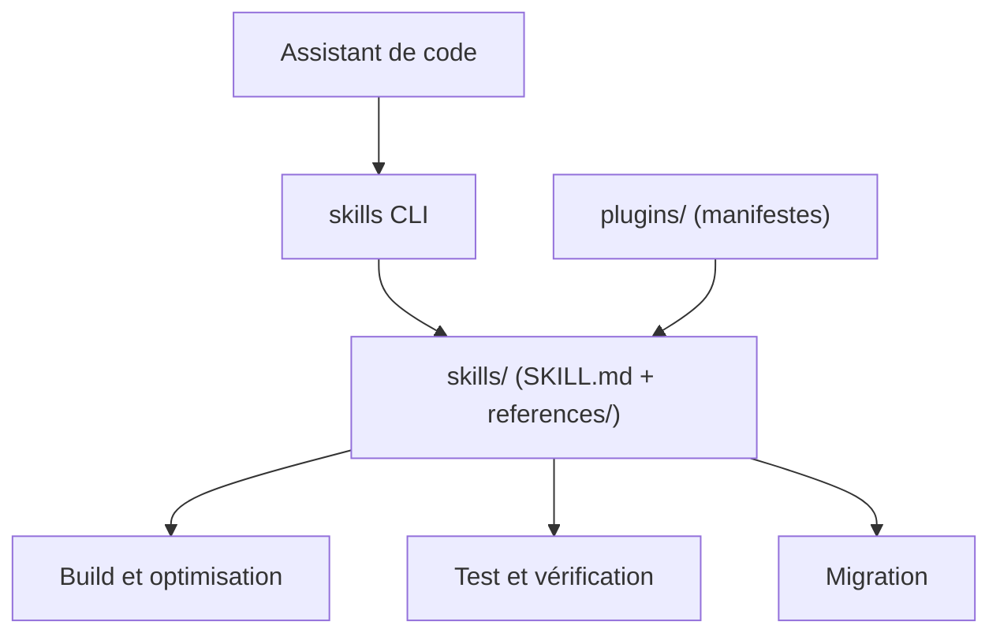

# callstackincubator/agent-skills

> Skills for coding assistants that bring React Native practices to anyone building mobile apps.

## The problem
A general-purpose coding assistant knows little about React Native's pitfalls: performance, navigation, version upgrades, migrating an existing native app.

## What it actually does
The repository gathers eleven skills (`SKILL.md` files with references) in three bundles: build and optimize, test and verify, migrate. The assistant picks the skill according to the requested task. Plugin manifests (Claude Code, Codex) assemble the bundles. The testing skills also include external skills linked in the README.

## How it is wired
Simplified diagram based on the fiche, no diagram provided.



## Trying it
```bash
npx skills@latest add callstackincubator/agent-skills --skill '*'
npx skills@latest add callstackincubator/agent-skills --skill react-native-best-practices
```

## Cost and gotchas
Free, under the MIT license. You need an assistant compatible with the skills CLI. The content is useful only if you write React Native.

## What it is not
Not a tool that runs on its own: these are instructions read by the assistant. Nothing for data or ML. The testing skills partly rely on third-party skills.

## Alternatives
- No alternative named in the README.

## For you
Ignore for a data / AI / MLOps profile: everything is centered on React Native, unless you are doing a one-off mobile project.
