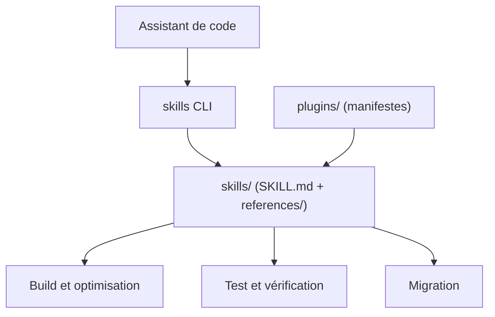

# callstackincubator/agent-skills

> Des skills pour assistants de code, qui apportent des pratiques React Native à qui développe des applis mobiles.

## Le problème
Un assistant de code généraliste connaît mal les pièges de React Native : performance, navigation, mises à jour de version, migration d'une appli native existante.

## Ce que ça fait vraiment
Le dépôt regroupe onze skills (fichiers `SKILL.md` avec des références) en trois lots : construire et optimiser, tester et vérifier, migrer. L'assistant choisit le skill selon la tâche demandée. Des manifestes de plugins (Claude Code, Codex) assemblent les lots. Les skills de test incluent aussi des skills externes liés dans le README.

## Comment c'est branché
Schéma simplifié d'après la fiche, sans diagramme fourni.



## Essayer
```bash
npx skills@latest add callstackincubator/agent-skills --skill '*'
npx skills@latest add callstackincubator/agent-skills --skill react-native-best-practices
```

## Coût et pièges
Gratuit, sous licence MIT. Il faut un assistant compatible avec le CLI skills. Le contenu est utile seulement si tu écris du React Native.

## Ce que ce n'est pas
Ce n'est pas un outil qui s'exécute seul : ce sont des consignes lues par l'assistant. Rien pour la donnée ou le ML. Les skills de test s'appuient en partie sur des skills tiers.

## Alternatives
- Aucune alternative nommée dans le README.

## Pour toi
À ignorer pour un profil data / IA / MLOps : tout est centré sur React Native, sauf si tu y fais un projet mobile ponctuel.

