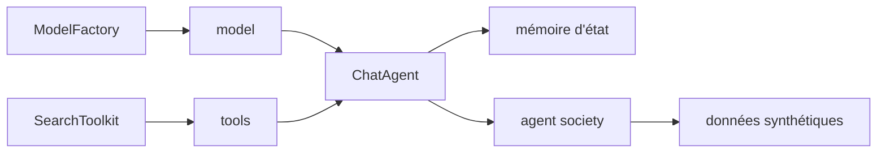

# camel-ai/camel

> Multi-agent research framework, designed to simulate large-scale societies of agents.

## The problem
Studying what cooperating agents do requires running many of them, for a long time, with memory.
Production-oriented frameworks are not suited to this kind of experiment or to data generation.

## What it actually does
Four stated principles: scalability through data generation, scaling up, stateful memory, code-as-prompt.
Claims simulation of up to a million agents to study emergent behaviors.
Separate modules: agents, agent societies, data generation, models, tools, memory, storage, benchmarks, retrievers.
Publishes synthetic datasets (AI Society, Code, Math, Physics, Chemistry, Biology) on Hugging Face.

## How it is wired


## Trying it
```bash
pip install camel-ai
pip install 'camel-ai[web_tools]'
export OPENAI_API_KEY='your_openai_api_key'
```
Then `ModelFactory.create(...)`, `ChatAgent(model=model, tools=[search_tool])`, `agent.step("What is CAMEL-AI?")`.
Optional logging: `export CAMEL_MODEL_LOG_ENABLED=true`.

## Cost and gotchas
Every agent step is a billed model call: a large-scale simulation gets expensive quickly.
The starter example assumes an OpenAI key and the `web_tools` extra for search.

## What it is not
Not a production-oriented framework: the README positions itself as a research collective.
Not a million agents at your place: it is a design capability, not a promise at your budget's scale.
Not a minimal library: the surface (modules, cookbooks, benchmarks) is broad to get a handle on.

## Alternatives
`ChatDev` — research project built on it, for communicating agents that develop software.
`Eigent` — product from the same ecosystem, for a multi-agent "workforce".

## For you
Worth a look if you want to generate synthetic data or study agent cooperation, not to ship a product.
