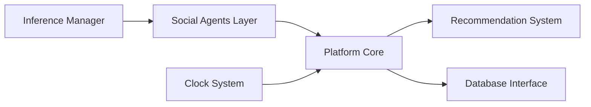

# camel-ai/oasis

> Social network simulator based on LLM agents, up to one million users, for researchers.

## The problem
Studying the spread of information, polarization or herd effects at scale without experimenting on real users.

## What it actually does
LLM agents act on simulated Twitter- and Reddit-like platforms: 23 action types (follow, comment, repost...), recommendation by interest or by "hot" score, SQLite storage. An `oasis.make` environment is driven step by step with manual actions or actions decided by the LLM.

## How it is wired


## Trying it
```bash
pip install camel-oasis
export OPENAI_API_KEY=<insert your OpenAI API key>
```
Then run the Python script from the README with `user_data_36.json` in `./data/reddit`.

## Cost and gotchas
Billed per token: 100 agents on one step consume ~335,600 input tokens (measured with QWEN_TURBO). Cost grows with agents, activation probability and time steps.

## What it is not
Does not prove real behaviors: it is a simulation. Scaling to a million agents depends on your budget.

## Alternatives
The README names no alternatives.

## For you
Worth watching: interesting for multi-agent simulation research, but measure the token budget before any large run.
