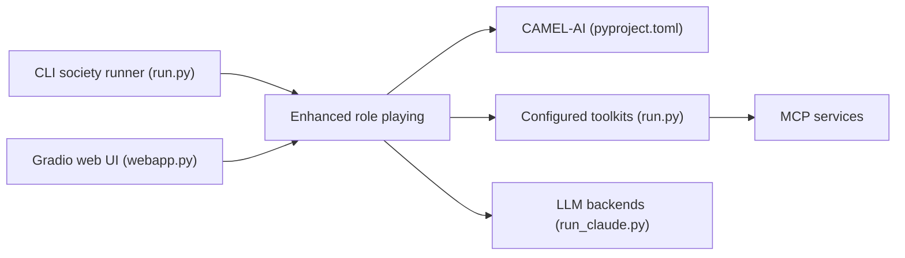

# camel-ai/owl

> Multi-agent framework built on CAMEL-AI to automate real-world tasks with tools and a browser.

## The problem
A single agent struggles on long tasks that mix web search, documents, code and browsing; orchestrating several roles requires a lot of glue code.

## What it actually does
Builds a role-playing "society" of agents (`construct_society`, `run_society`) that exchange messages and tool calls until an answer is reached.
CAMEL toolkits: search (Google, DuckDuckGo, Wikipedia…), Playwright browser, image/video/audio analysis, documents, code execution, MCP.
Local Gradio interface in English, Chinese and Japanese.
Announced GAIA score of 69.09, reproducible on the `gaia69` branch.

## How it is wired


## Trying it
```bash
git clone https://github.com/camel-ai/owl.git
cd owl
pip install uv
uv venv .venv --python=3.10
uv pip install -e .
python examples/run_mini.py
python owl/webapp.py
```

## Cost and gotchas
Each task consumes tokens from your provider; models with tool calling and multimodal support are required. MCP requires Node.js; Docker is possible.

## What it is not
Not a finished product: the core delegates almost everything to CAMEL. The GAIA score depends on a modified branch and a modified CAMEL version. No license declared.

## Alternatives
- CAMEL: the underlying framework, to be used directly if you do not need the OWL layer.

## For you
Worth watching: a good base for reading about multi-agent architectures, but the absence of a license blocks any use other than experimental.
