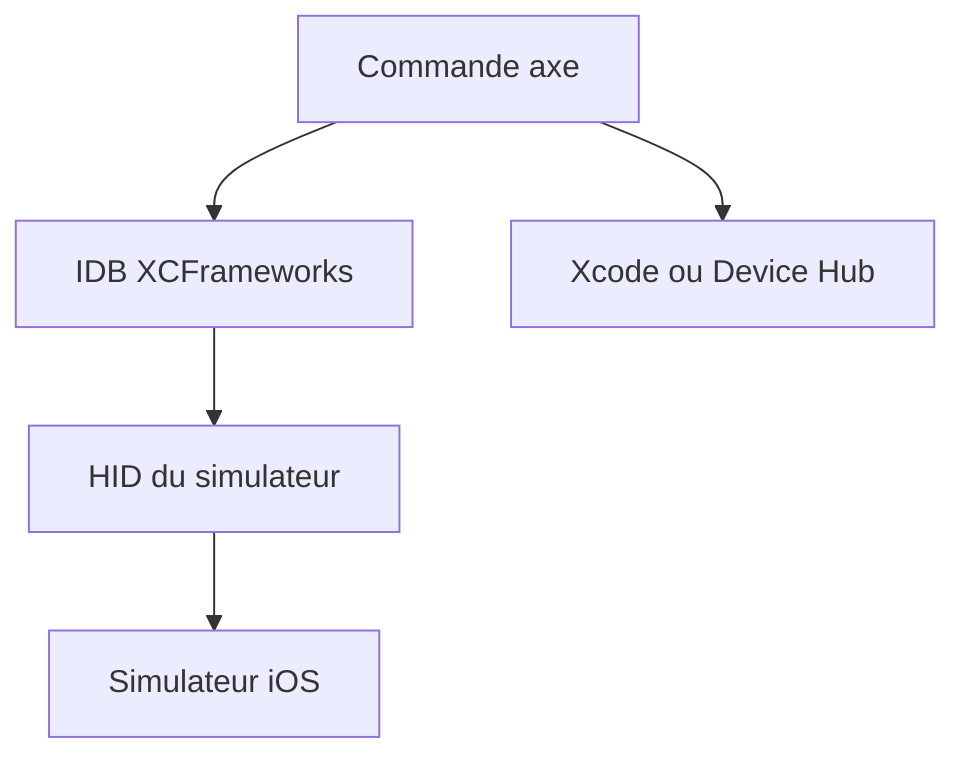

# cameroncooke/AXe

> A command-line tool to drive an iOS simulator (touch, typing, capture), for iOS developers.

## The problem
Automating an iOS simulator from a script requires handling Apple's HID APIs, which are impractical to call directly.

## What it actually does
AXe exposes simulator interactions as commands: list simulators, describe the current interface, tap by label, type text, take a screenshot. It relies on IDB (rebuilt from a pinned fork) and works with Xcode 26 and 27. End-to-end tests are run with make e2e.

## How it is wired
Simplified diagram based on the sheet, no diagram provided.


## Trying it
```bash
brew tap cameroncooke/axe
brew install axe
axe list-simulators
axe describe-ui --udid "$UDID"
axe tap --label "Continue" --udid "$UDID"
axe screenshot --output ./screen.png --udid "$UDID"
```

## Cost and gotchas
Free, but macOS only with Xcode installed (Homebrew and Xcode are assumed by the README). Tests require XcodeGen.

## What it is not
Not an accessibility tool: the README states it has no relation to Deque Systems and its axe product. It only drives simulators, not real devices.

## Alternatives
No alternative named in the README.

## For you
Ignore: useful only for testing iOS applications, which falls outside a data / AI / MLOps profile.
