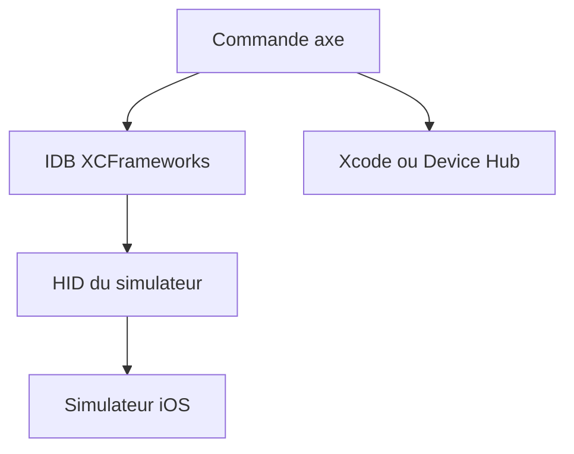

# cameroncooke/AXe

> Un outil en ligne de commande pour piloter un simulateur iOS (toucher, saisie, capture), pour développeurs iOS.

## Le problème
Automatiser un simulateur iOS depuis un script demande de manipuler les API HID d'Apple, peu pratiques à appeler directement.

## Ce que ça fait vraiment
AXe expose en commandes les interactions du simulateur : lister les simulateurs, décrire l'interface courante, toucher par libellé, taper du texte, faire une capture d'écran. Il s'appuie sur IDB (reconstruit depuis un fork figé) et fonctionne avec Xcode 26 et 27. Les tests de bout en bout se lancent par make e2e.

## Comment c'est branché
Schéma simplifié d'après la fiche, sans diagramme fourni.


## Essayer
```bash
brew tap cameroncooke/axe
brew install axe
axe list-simulators
axe describe-ui --udid "$UDID"
axe tap --label "Continue" --udid "$UDID"
axe screenshot --output ./screen.png --udid "$UDID"
```

## Coût et pièges
Gratuit, mais réservé à macOS avec Xcode installé (Homebrew et Xcode sont supposés par le README). Les tests demandent XcodeGen.

## Ce que ce n'est pas
Pas un outil d'accessibilité : le README précise qu'il n'a aucun lien avec Deque Systems et son produit axe. Il ne pilote que des simulateurs, pas des appareils réels.

## Alternatives
Aucune alternative nommée dans le README.

## Pour toi
À ignorer : utile seulement pour tester des applications iOS, ce qui sort d'un profil data / IA / MLOps.

