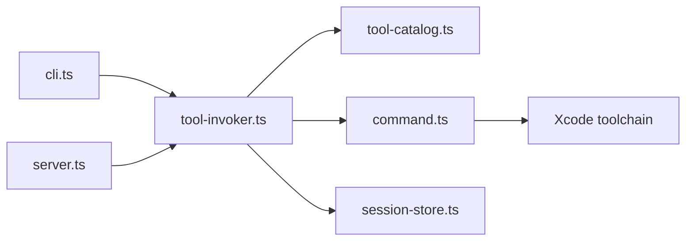

# cameroncooke/XcodeBuildMCP

> MCP server and CLI that give an agent the tools to build iOS and macOS apps.

## The problem
A coding agent cannot drive Xcode, simulators and devices without dedicated tools.

## What it actually does
Exposes, via MCP and the command line, building, testing, simulators and devices, UI automation, debugging, coverage, project discovery and the Swift Package Manager. One daemon per workspace handles stateful operations (logs, debugging). Two optional skills (MCP, CLI) are installed with `init`. Requires macOS 14.5+ and Xcode 16+.

## How it is wired


## Trying it
```bash
brew tap getsentry/xcodebuildmcp
brew install xcodebuildmcp
xcodebuildmcp --help
xcodebuildmcp tools
xcodebuildmcp simulator build --scheme MyApp --project-path ./MyApp.xcodeproj
```

## Cost and gotchas
Free. Sentry collects error telemetry (can be disabled, see the Privacy page). On-device tools require code signing configured in Xcode.

## What it is not
Not cross-platform: macOS and Xcode only. The architecture diagram names it "MobileBuildMCP", a name absent from the README.

## Alternatives
No alternative cited in the README.

## For you
Ignore: only useful for iOS/macOS development, unrelated to data/AI/MLOps work.
