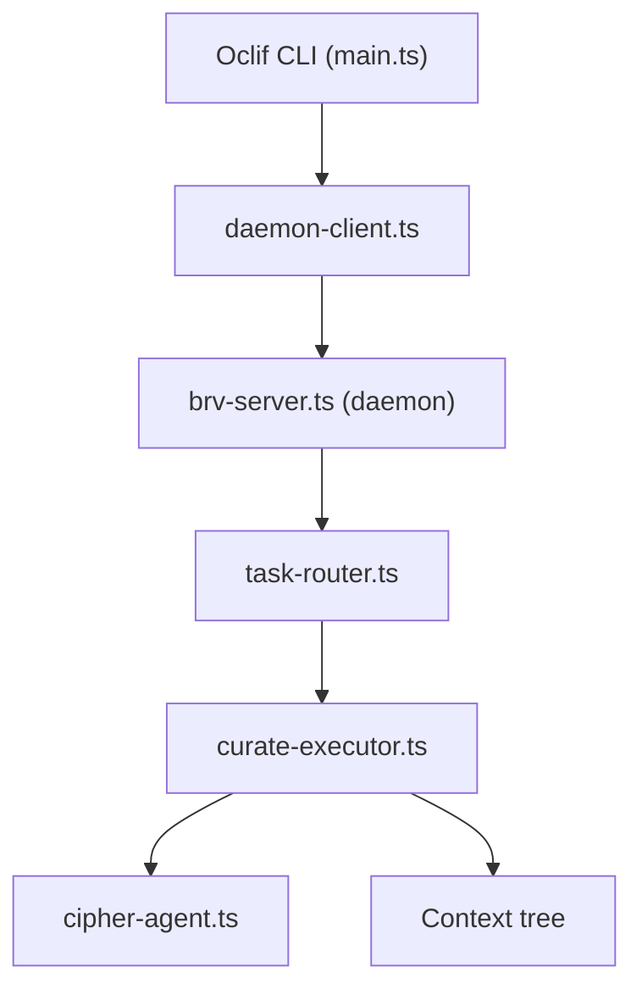

# campfirein/byterover-cli

> CLI that gives AI coding agents a persistent, versioned context memory.

## The problem
Coding agents forget project knowledge from one session to the next.

## What it actually does
A REPL (`brv`) and a web dashboard for curating knowledge in a Git-style versioned "context tree" (branches, commits, merges, push/pull). Twenty LLM providers, 24 agent tools, an MCP server and connectors for more than twenty coding agents. A local daemon manages projects and agents. Claims 96.1% on LoCoMo and 92.8% on LongMemEval-S.

## How it is wired


## Trying it
```bash
npm install -g byterover-cli
brv --version
cd your/project
brv
```

## Cost and gotchas
Node 20 or later (or an install script). An LLM provider key is required; a limited free hosted LLM exists. The team cloud is a separate offering. License not identified by GitHub, repository archived.

## What it is not
Not a generic vector database: it is a project knowledge memory. The announced scores come from the authors.

## Alternatives
No alternative named in the README.

## For you
Ignore as a dependency, since it is archived; the paper and the idea of a versioned context tree remain worth reading for agent memory.
