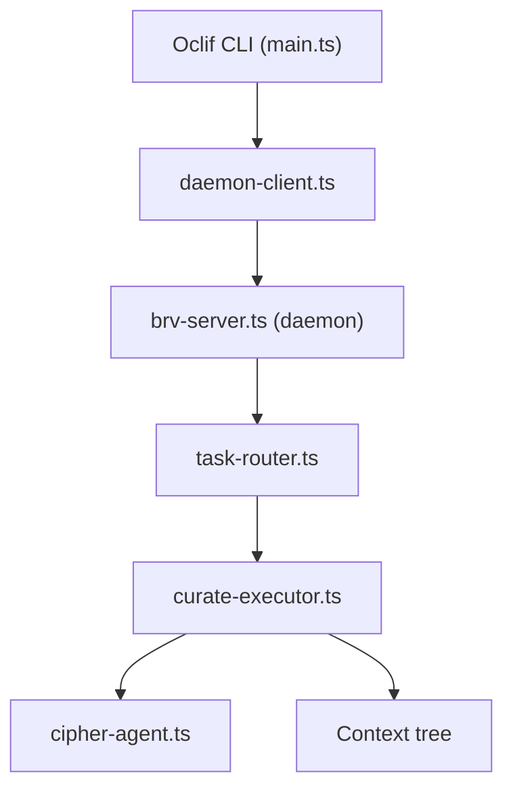

# campfirein/byterover-cli

> CLI qui donne une mémoire de contexte persistante et versionnée aux agents de code IA.

## Le problème
Les agents de code oublient les connaissances du projet d'une session à l'autre.

## Ce que ça fait vraiment
Un REPL (`brv`) et un tableau de bord web pour curer des connaissances dans un « arbre de contexte » versionné façon Git (branches, commits, fusions, push/pull). Vingt fournisseurs de LLM, 24 outils d'agent, serveur MCP et connecteurs pour plus de vingt agents de code. Un démon local gère les projets et les agents. Annonce 96,1 % sur LoCoMo et 92,8 % sur LongMemEval-S.

## Comment c'est branché


## Essayer
```bash
npm install -g byterover-cli
brv --version
cd your/project
brv
```

## Coût et pièges
Node 20 ou plus (ou script d'installation). Une clé de fournisseur LLM est requise, un LLM hébergé gratuit limité existe. Le cloud d'équipe est une offre à part. Licence non identifiée par GitHub, dépôt archivé.

## Ce que ce n'est pas
Pas une base vectorielle générique : c'est une mémoire de connaissances de projet. Les scores annoncés viennent des auteurs.

## Alternatives
Aucune alternative nommée dans le README.

## Pour toi
À ignorer comme dépendance, car archivé ; le papier et l'idée d'arbre de contexte versionné restent à lire pour la mémoire d'agents.

