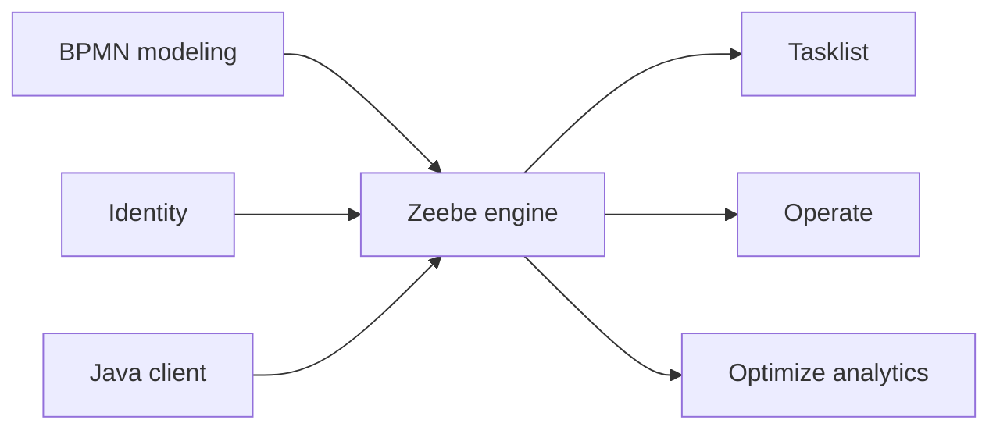

# camunda/camunda

> BPMN/DMN process orchestration platform (Camunda 8): Zeebe engine, Tasklist, Operate, Optimize.

## The problem
Coordinating business processes that mix people, systems and devices, with traceability.

## What it actually does
Repository of the orchestration cluster components: Zeebe (BPMN/DMN engine), Tasklist (human tasks), Operate (monitoring), Identity, Optimize (analytics). Java and Spring Boot clients; horizontal scaling, no relational database required; reacts to Kafka messages. Modeler, Console and Connectors are outside this repository.

## How it is wired


## Trying it
```bash
cd monorepo-docs-site
npm install
npm start
```
(This launches the documentation site, not the engine; prebuilt Docker images are listed in the README.)

## Cost and gotchas
Catalog: license "none". The README cites the Camunda License 1.0 for the gateway protocol: read the commercial terms before production use. 2,992 open issues.

## What it is not
Not an ML tool nor a data pipeline orchestrator like Airflow: it is business process orchestration.

## Alternatives
No alternative named in the README.

## For you
Worth watching: interesting for automating business workflows around models, but the license needs clarifying first.
