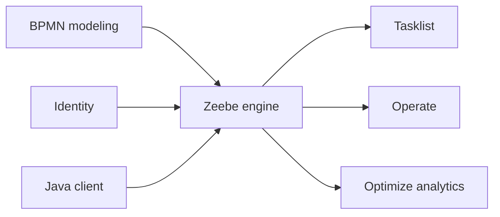

# camunda/camunda

> Plateforme d'orchestration de processus BPMN/DMN (Camunda 8) : moteur Zeebe, Tasklist, Operate, Optimize.

## Le problème
Coordonner des processus métier qui mêlent personnes, systèmes et appareils, avec traçabilité.

## Ce que ça fait vraiment
Dépôt des composants du cluster d'orchestration : Zeebe (moteur BPMN/DMN), Tasklist (tâches humaines), Operate (suivi), Identity, Optimize (analytique). Clients Java et Spring Boot ; passage à l'échelle horizontal, sans base relationnelle requise ; réaction aux messages Kafka. Modeler, Console, Connectors sont hors de ce dépôt.

## Comment c'est branché


## Essayer
```bash
cd monorepo-docs-site
npm install
npm start
```
(Cela lance le site de doc, pas le moteur ; images Docker préconstruites listées dans le README.)

## Coût et pièges
Catalogue : licence « aucune ». Le README cite la Camunda License 1.0 pour le protocole du gateway : conditions commerciales à lire avant usage en production. 2 992 issues ouvertes.

## Ce que ce n'est pas
Pas un outil ML ni un orchestrateur de pipelines de données type Airflow : c'est de l'orchestration de processus métier.

## Alternatives
Aucune alternative nommée dans le README.

## Pour toi
À surveiller : intéressant pour automatiser des workflows métier autour de modèles, mais licence à clarifier d'abord.

