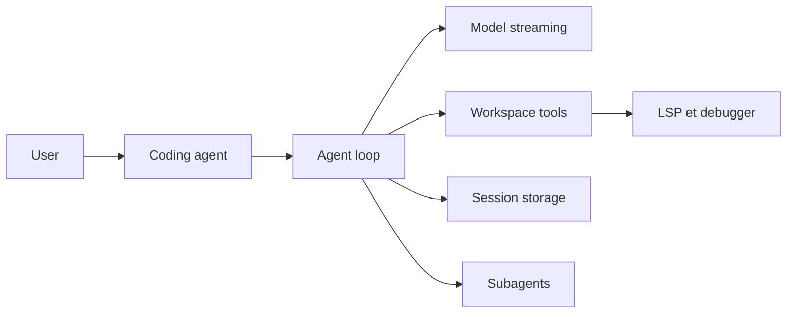

# can1357/oh-my-pi

> Terminal coding agent (a fork of Pi) with LSP, debugger, subagents and a Rust core, for developers.

## The problem
Conventional coding agents edit blindly (edit error feedback, slow searches) and ignore what the IDE knows.

## What it actually does
Interactive agent (TUI), one-shot mode, RPC and ACP for Zed. Built-in tools: hash-anchored editing, `ast_grep`, `lsp`, `debug` (DAP), shell and search run in-process (Rust core of ~80k lines), subagents isolated per worktree, an "advisor" reviewer. More than 60 model providers, configurable model roles, optional memory. Imports rules and skills from `.claude`, `.cursor`, `.codex`, etc.

## How it is wired


## Trying it
```bash
curl -fsSL https://omp.sh/install | sh
brew install can1357/tap/omp
bun install -g @oh-my-pi/pi-coding-agent
omp
```

## Cost and gotchas
API key or provider subscription at your expense. The install script is a `curl | sh`. Opening a repository loads its extensions, hooks and MCP config by design (repository trust model). 4,202 open issues.

## What it is not
Not an IDE nor a model: it is a harness around third-party models. The gain figures ("benchmaxxed") come from the README, with no detailed protocol here.

## Alternatives
Pi by Mario Zechner (of which this is a fork), according to the README.

## For you
Worth watching: interesting for an MLOps profile that wants a controllable agent (RPC, SDK) across multiple providers, but the volume of issues and the wide surface call for a trial before adopting.
