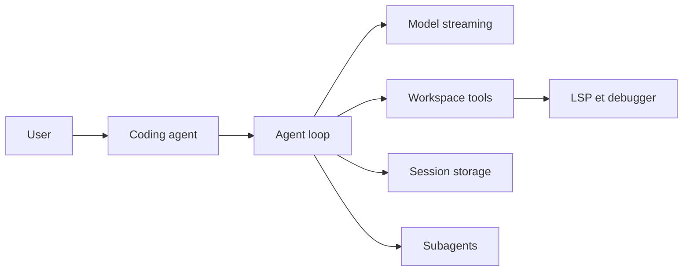

# can1357/oh-my-pi

> Agent de code en terminal (fork de Pi) avec LSP, débogueur, sous-agents et cœur Rust, pour développeurs.

## Le problème
Les agents de code classiques éditent à l'aveugle (retours d'erreur d'édition, recherches lentes) et ignorent ce que l'IDE sait.

## Ce que ça fait vraiment
Agent interactif (TUI), mode one-shot, RPC et ACP pour Zed. Outils intégrés : édition par ancres de hash, `ast_grep`, `lsp`, `debug` (DAP), shell et recherche exécutés in-process (cœur Rust ~80k lignes), sous-agents isolés par worktree, relecteur « advisor ». Plus de 60 fournisseurs de modèles, rôles de modèles configurables, mémoire optionnelle. Importe les règles et skills de `.claude`, `.cursor`, `.codex`, etc.

## Comment c'est branché


## Essayer
```bash
curl -fsSL https://omp.sh/install | sh
brew install can1357/tap/omp
bun install -g @oh-my-pi/pi-coding-agent
omp
```

## Coût et pièges
Clé d'API ou abonnement fournisseur à ta charge. Le script d'installation est un `curl | sh`. Ouvrir un dépôt charge ses extensions, hooks et config MCP par conception (modèle de confiance du dépôt). 4 202 issues ouvertes.

## Ce que ce n'est pas
Pas un IDE ni un modèle : c'est un harnais autour de modèles tiers. Les chiffres de gains (« benchmaxxed ») viennent du README, sans protocole détaillé ici.

## Alternatives
Pi de Mario Zechner (dont c'est un fork), selon le README.

## Pour toi
À surveiller : intéressant pour un profil MLOps qui veut un agent pilotable (RPC, SDK) multi-fournisseurs, mais le volume d'issues et la surface large demandent un essai avant d'adopter.

