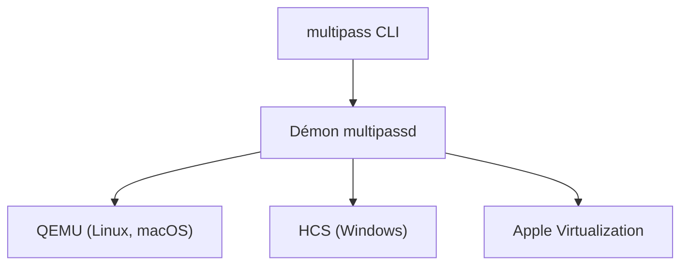

# canonical/multipass

> One-command Ubuntu virtual machine manager, for developers on Linux, Windows, macOS.

## The problem
Getting a fresh, disposable Linux environment on your workstation is slow to set up.

## What it actually does
Launches VMs via QEMU (Linux), HCS (Windows) or QEMU / Apple Virtualization (macOS). Downloads and updates images, supports cloud-init to simulate a small cloud deployment. Commands `launch`, `shell`, `exec`, `stop`, `delete`.

## How it is wired

Diagram inferred from the README: the daemon's name is an assumption not written in the text.

## Trying it
```bash
sudo snap install multipass
multipass launch lts
multipass list
multipass shell <nom>
multipass exec <nom> -- <commande>
multipass stop <nom>
multipass delete <nom>
```

## Cost and gotchas
Free. On macOS, you may need to disable the firewall. Only the official installers are supported (unofficial Homebrew).

## What it is not
Not a container orchestrator nor a GPU tool. GPL-3.0 license: copyleft.

## Alternatives
No alternative named in the README (third-party extensions are listed: MCP server, Terraform providers, VS Code extensions).

## For you
Adopt: handy for testing MLOps scripts or disposable Linux environments, with a GPL license that has no consequence for local use.
