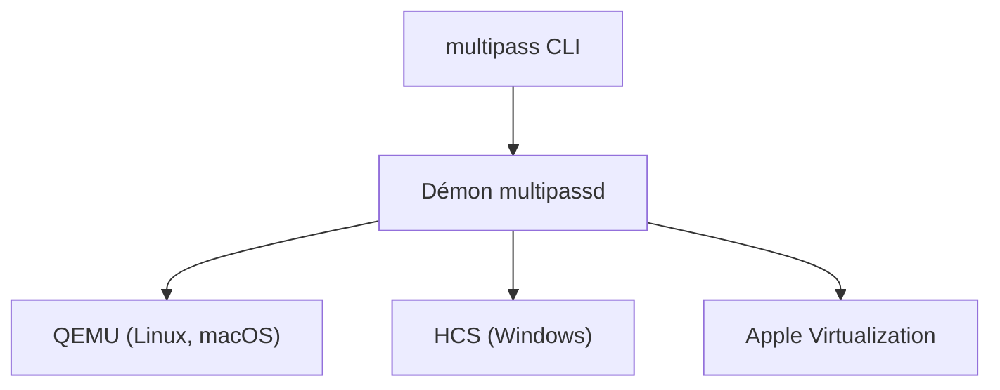

# canonical/multipass

> Gestionnaire de machines virtuelles Ubuntu en une commande, pour développeurs sous Linux, Windows, macOS.

## Le problème
Obtenir un environnement Linux neuf et jetable sur son poste est lent à configurer.

## Ce que ça fait vraiment
Lance des VM via QEMU (Linux), HCS (Windows) ou QEMU / Apple Virtualization (macOS). Télécharge et met à jour les images, prend en charge cloud-init pour simuler un petit déploiement cloud. Commandes `launch`, `shell`, `exec`, `stop`, `delete`.

## Comment c'est branché

Schéma déduit du README : le nom du démon est une hypothèse non écrite dans le texte.

## Essayer
```bash
sudo snap install multipass
multipass launch lts
multipass list
multipass shell <nom>
multipass exec <nom> -- <commande>
multipass stop <nom>
multipass delete <nom>
```

## Coût et pièges
Gratuit. Sur macOS, il peut falloir désactiver le pare-feu. Seuls les installeurs officiels sont supportés (Homebrew non officiel).

## Ce que ce n'est pas
Pas un orchestrateur de conteneurs ni un outil GPU. Licence GPL-3.0 : copyleft.

## Alternatives
Aucune alternative nommée dans le README (des extensions tierces sont listées : serveur MCP, providers Terraform, extensions VS Code).

## Pour toi
Adopter : pratique pour tester des scripts MLOps ou des environnements Linux jetables, avec une licence GPL sans conséquence pour un usage local.

