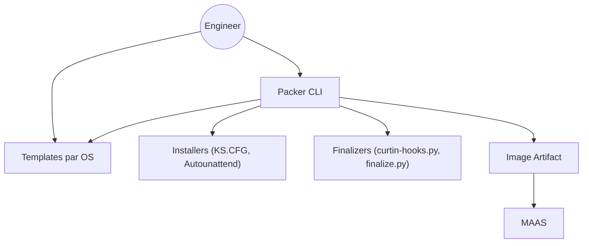

# canonical/packer-maas

> Packer templates to build custom OS images to deploy with MAAS, aimed at infrastructure administrators.

## The problem
MAAS only provides standard Ubuntu images, while you need hardened images or other OSes (RHEL, SLES, Windows, ESXi).

## What it actually does
Each OS has its own folder: HCL2 template, scripts, automatic installation files, Makefile. Packer runs the build in a virtual machine, finalization scripts adapt the image to MAAS, then you upload it with the maas CLI. Maturity levels range from Alpha to Stable depending on the OS.

## How it is wired
Diagram based on the code diagram.


## Trying it
```bash
packer version
git clone https://github.com/canonical/packer-maas.git
cd packer-maas/ubuntu
make custom-ubuntu-lvm.dd.gz
maas admin boot-resources create name='custom/ubuntu-raw' title='Ubuntu Custom RAW' architecture='amd64/generic' filetype='ddgz' content@=custom-ubuntu-lvm.dd.gz
```

## Cost and gotchas
Free. Ubuntu host with 4 cores, 8 GB of RAM, 25 GB of disk, hardware virtualization, Packer and QEMU. A MAAS server is required. The license is present but not identified.

## What it is not
Not a deployment tool: it builds images for MAAS. The CentOS, RHEL 7 and ESXi 6 templates are end-of-life, and several others are in Beta.

## Alternatives
No alternative named in the README.

## For you
Ignore: only useful if you administer a fleet of bare-metal servers with MAAS, not for data or AI work.
