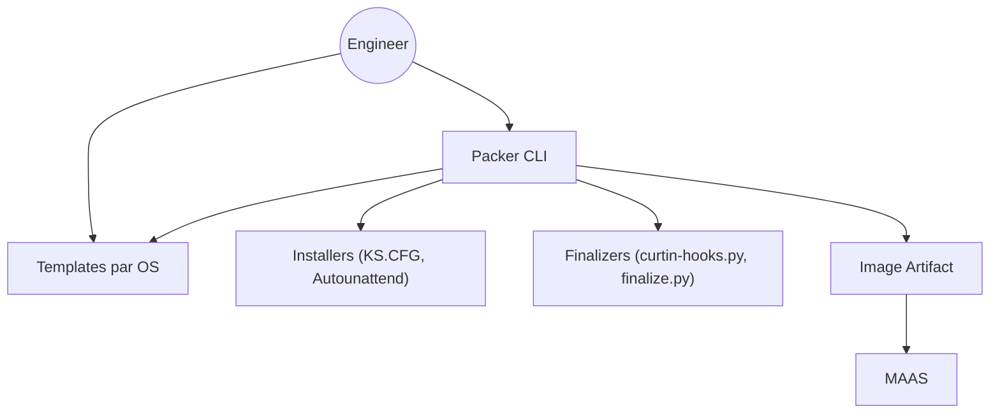

# canonical/packer-maas

> Modèles Packer pour construire des images d'OS sur mesure à déployer avec MAAS, côté administrateur d'infrastructure.

## Le problème
MAAS ne fournit que des images Ubuntu standard, alors qu'il faut des images durcies ou d'autres OS (RHEL, SLES, Windows, ESXi).

## Ce que ça fait vraiment
Chaque OS a son dossier : modèle HCL2, scripts, fichiers d'installation automatique, Makefile. Packer lance la construction dans une machine virtuelle, des scripts de finalisation adaptent l'image à MAAS, puis on la téléverse avec la CLI maas. Les niveaux de maturité vont d'Alpha à Stable selon l'OS.

## Comment c'est branché
Schéma d'après le diagramme du code.


## Essayer
```bash
packer version
git clone https://github.com/canonical/packer-maas.git
cd packer-maas/ubuntu
make custom-ubuntu-lvm.dd.gz
maas admin boot-resources create name='custom/ubuntu-raw' title='Ubuntu Custom RAW' architecture='amd64/generic' filetype='ddgz' content@=custom-ubuntu-lvm.dd.gz
```

## Coût et pièges
Gratuit. Hôte Ubuntu avec 4 cœurs, 8 Go de RAM, 25 Go de disque, virtualisation matérielle, Packer et QEMU. Un serveur MAAS est nécessaire. La licence est présente mais non identifiée.

## Ce que ce n'est pas
Ce n'est pas un outil de déploiement : il fabrique des images pour MAAS. Les modèles CentOS, RHEL 7 et ESXi 6 sont en fin de vie, plusieurs autres en Beta.

## Alternatives
Aucune alternative nommée dans le README.

## Pour toi
À ignorer : utile seulement si tu administres un parc de serveurs nus avec MAAS, pas pour un travail data ou IA.

