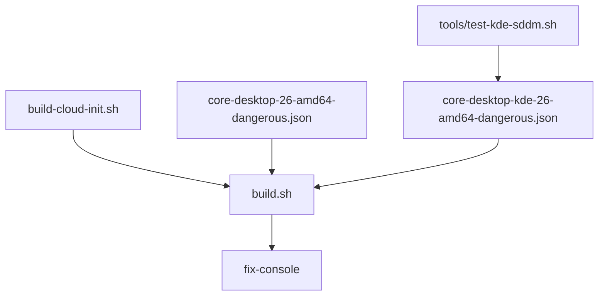

# canonical/ubuntu-core-desktop

> Build scripts for Ubuntu Core 26 images with a GNOME or KDE desktop, in confined snaps.

## The problem
Ubuntu Core has no ready-to-use graphical desktop.

## What it actually does
Scripts (`build.sh`, `build-cloud-init.sh`) assemble a disk image from a GNOME or KDE JSON model. GNOME uses GDM, KDE uses SDDM. The base, gadget and session snaps are managed in other repositories. The image runs in a virtual machine (virt-install or QEMU).

## How it is wired
Diagram based on the code diagram.



## Trying it
```bash
virt-install --connect qemu:///session --name core-desktop \
  --memory 2048 --vcpus 2 --boot uefi --os-variant ubuntu24.04 \
  --video virtio,accel3d=no --graphics spice \
  --import --disk path=$(pwd)/pc.img,format=raw
./go-run-kde
```

## Cost and gotchas
Free. Repository without a declared license. The README warns that the root account is left with an empty password and that the wizard does not make the user an administrator.

## What it is not
Not a production-ready system: the models are called "dangerous" and mixed GDM/KDE sessions are not supported.

## Alternatives
None cited in the README.

## For you
Ignore: desktop Linux distribution experimentation, outside the data / AI / MLOps field.
