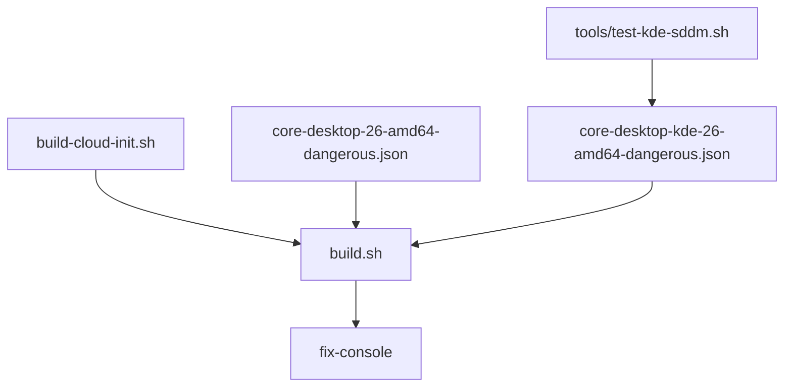

# canonical/ubuntu-core-desktop

> Scripts de construction d'images Ubuntu Core 26 avec bureau GNOME ou KDE, en snaps confinés.

## Le problème
Ubuntu Core n'a pas de bureau graphique prêt à l'emploi.

## Ce que ça fait vraiment
Des scripts (`build.sh`, `build-cloud-init.sh`) assemblent une image disque à partir d'un modèle JSON GNOME ou KDE. GNOME utilise GDM, KDE utilise SDDM. Les snaps de base, de gadget et de session sont gérés dans d'autres dépôts. L'image se lance dans une machine virtuelle (virt-install ou QEMU).

## Comment c'est branché
Schéma d'après le diagramme du code.



## Essayer
```bash
virt-install --connect qemu:///session --name core-desktop \
  --memory 2048 --vcpus 2 --boot uefi --os-variant ubuntu24.04 \
  --video virtio,accel3d=no --graphics spice \
  --import --disk path=$(pwd)/pc.img,format=raw
./go-run-kde
```

## Coût et pièges
Gratuit. Dépôt sans licence déclarée. Le README signale que le compte root est laissé avec un mot de passe vide et que l'assistant ne rend pas l'utilisateur administrateur.

## Ce que ce n'est pas
Pas un système prêt pour la production : les modèles s'appellent « dangerous » et les sessions mixtes GDM/KDE ne sont pas prises en charge.

## Alternatives
Aucune citée dans le README.

## Pour toi
Ignorer : expérimentation de distribution Linux de bureau, hors du champ data / IA / MLOps.

