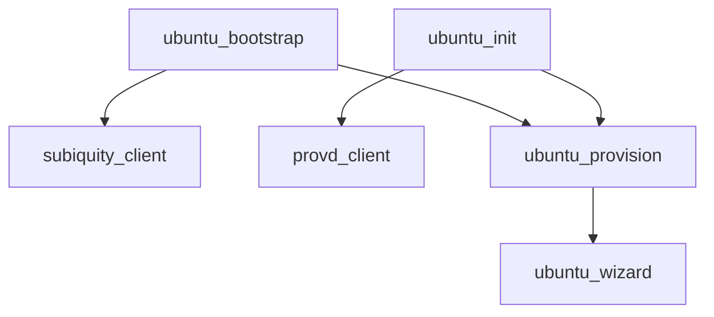

# canonical/ubuntu-desktop-provision

> Flutter interface for the Ubuntu Desktop installer and first-boot setup.

## The problem
Installing and configuring Ubuntu requires a unified interface that variants and manufacturers (OEMs) can customize.

## What it actually does
Flutter monorepo: `ubuntu_bootstrap` drives the `subiquity` backend during installation, `ubuntu_init` drives `provd` at first boot. A YAML file (`whitelabel.yaml`) customizes the theme, pages, slideshow and EULA. The result is shipped as snaps.

## How it is wired
Simplified diagram based on the sheet, no diagram provided.



## Trying it
```bash
# Aucune commande documentée : la configuration se fait via
# /usr/share/desktop-provision/whitelabel.yaml
```

## Cost and gotchas
Free. The README points to the backend, whose section is empty ("TODO"). The snaps are built by dedicated branches on Launchpad. GPL-3.0 license (copyleft), not flagged as an alert here.

## What it is not
Not a standalone installer: it is only the interface layer, which depends on subiquity and provd.

## Alternatives
None cited in the README.

## For you
Ignore: it is for maintainers of Ubuntu distributions, not for data / AI / MLOps work.
