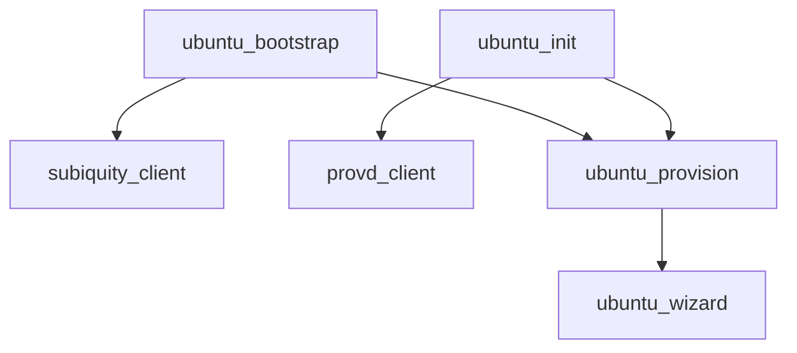

# canonical/ubuntu-desktop-provision

> Interface Flutter de l'installeur et de la première configuration d'Ubuntu Desktop.

## Le problème
Installer et configurer Ubuntu demande une interface unifiée, personnalisable par les variantes et les fabricants (OEM).

## Ce que ça fait vraiment
Monorepo Flutter : `ubuntu_bootstrap` pilote le backend `subiquity` pendant l'installation, `ubuntu_init` pilote `provd` au premier démarrage. Un fichier YAML (`whitelabel.yaml`) personnalise thème, pages, diaporama et CLUF. Le résultat est livré sous forme de snaps.

## Comment c'est branché
Schéma simplifié d'après la fiche, sans diagramme fourni.



## Essayer
```bash
# Aucune commande documentée : la configuration se fait via
# /usr/share/desktop-provision/whitelabel.yaml
```

## Coût et pièges
Gratuit. Le README renvoie au backend, dont la section est vide (« TODO »). Les snaps sont construits par des branches dédiées sur Launchpad. Licence GPL-3.0 (copyleft), non signalée comme alerte ici.

## Ce que ce n'est pas
Pas un installeur autonome : c'est la seule couche d'interface, qui dépend de subiquity et de provd.

## Alternatives
Aucune citée dans le README.

## Pour toi
Ignorer : sert aux mainteneurs de distributions Ubuntu, pas à un travail data / IA / MLOps.

